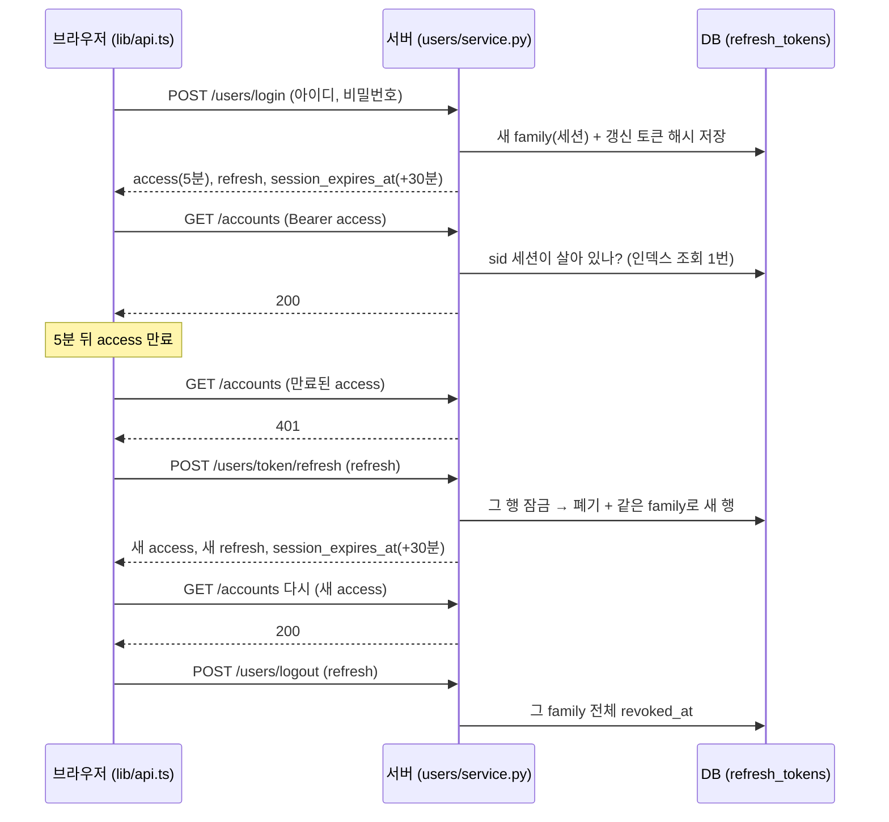

# 로그인·세션 구조 (학습용 설명)

2026-11-08에 바꾼 인증 구조를 **무엇을, 왜, 어떻게** 바꿨는지 따라가며 이해할 수 있게 정리한 문서다. 변경 이력(변경 전/후 인용, 검증)은 [DESIGN_CHANGES.md](DESIGN_CHANGES.md)의 C-082 ~ C-086에 있다.

## 0. 한눈에

| 바뀐 것 | 예전 | 지금 | 이유 |
|---|---|---|---|
| 토큰 | 30분짜리 JWT 하나 | **액세스 토큰(5분 JWT) + 갱신 토큰(30분, 서버 DB에 해시)** | 비밀번호를 바꾸거나 로그아웃해도 서버가 세션을 끊을 수 없었다 |
| 로그인 실패 한도 | 동시 요청 30개가 모두 검증됨(한도 5 무력화) | 정확히 5개만 검증. 이후 C-090에서 **5회 연속 오류 → 잠금(DB)**, 해제는 비밀번호 찾기 | 확인과 기록 사이에 `await`가 끼어 있었다 / 국내 규정 |
| 비밀번호를 잊으면 | 방법 없음 | **계좌번호 + 계좌 비밀번호 + 휴대폰 인증번호**로 아이디 찾기·비밀번호 재설정 (9-3장) | 국내 은행 방식 조사 결과 |
| 화면 | 30분 뒤 "만료된 토큰" 문구만 뜨고 그대로 | 남은 시간 타이머, 2분 전 예고, 만료되면 로그인 화면 → 다시 로그인하면 보던 화면 | 사용자가 언제 끊기는지 모르고, 끊긴 뒤 할 일을 몰랐다 |
| 입력 | 공백 아이디·대문자 중복·아무 전화번호·약한 비밀번호 가입 가능 | 아이디·이름·전화번호 정규화, 비밀번호 영문·숫자·특수문자 | 같은 사람이 다른 계정으로 갈라지고, 휴대폰 자동 대문자로 로그인 실패 |
| 422 오류 | `phone: String should have at most 20 characters` | `휴대폰 번호는 20자 이하로 입력해 주세요.` | 영어·필드명이 사용자에게 그대로 보였다 |
| 토큰 보관 | 두 토큰을 `localStorage`에 (XSS가 읽어 갈 수 있음) | **갱신 토큰은 `httpOnly` 쿠키, 액세스 토큰은 브라우저 메모리**, `localStorage`엔 만료 시각만 (9-5장, C-096) | 스크립트가 읽을 수 없으면 훔칠 수도 없다 |
| 새 기기 | 비밀번호만 맞으면 어디서든 로그인 | **기기 등록**: 모르는 기기는 비밀번호 + 휴대폰 인증번호, 실패 한도는 등록 기기·새 기기 따로 (9-5장, C-096) | 남이 일부러 틀려서 주인을 잠글 수 없게 |

---

## 1. 왜 토큰을 두 개로 나눴나

### 예전 구조의 문제
JWT는 **서버가 저장하지 않는다.** 서명만 확인하면 되니 빠르고 DB 조회가 없지만, 그 대가로 **한 번 발급하면 만료 전까지 서버가 취소할 수 없다.**
- 토큰을 도난당해서 비밀번호를 바꿔도 → 훔친 토큰은 최대 30분 더 유효했다.
- 로그아웃 버튼은 브라우저에서 토큰을 지울 뿐 → 서버 입장에서는 아무 일도 없었다.

### 해결: 역할을 나눈다
| | 액세스 토큰 | 갱신 토큰 (refresh token) |
|---|---|---|
| 모양 | JWT (`sub`, `iat`, `exp`, HS256) | 의미 없는 256비트 임의 문자열 |
| 수명 | **5분** | **30분**, 갱신할 때마다 다시 30분(슬라이딩) |
| 서버 저장 | 안 함 (서명 + **세션 번호 `sid`가 살아 있는지 확인**, 9-1장) | **함** (`refresh_tokens` 테이블, SHA-256 해시만) |
| 쓰는 곳 | 모든 보호된 API의 `Authorization: Bearer` | `POST /users/token/refresh` 하나 |
| 취소 | 그 세션이 끊기면 **다음 요청부터 바로 거절** (처음엔 불가였음, 9-1장) | 가능 (`revoked_at`) |

- 자주 쓰는 액세스 토큰은 무상태로 둬서 **요청마다 DB를 볼 필요가 없게** 하고,
- 세션을 이어 주는 갱신 토큰만 DB에 둬서 **서버가 끊을 수 있게** 했다.
- 처음 구현(C-083)에서는 끊은 뒤에도 "이미 발급된 액세스 토큰 최대 5분"이 남았다. 은행에서 받아들이기 어려워 요청마다 세션을 확인하도록 바꿨다(C-087, 아래 9-1장).

> 다른 방법(A안)은 토큰 하나를 유지하고 `users.token_version`을 요청마다 비교하는 것이었다. 더 단순하지만 사용자가 정석 구조를 배우려고 B안을 골랐다.

설정은 [core/config.py](../src/avengers_bank/core/config.py)의 `access_token_expire_minutes = 5`, `session_expire_minutes = 30` (예전 `jwt_expire_minutes = 30`은 이름이 바뀌었다).

---

## 2. 전체 흐름

> C-096 이후에는 아래 그림의 "refresh"가 요청·응답 본문이 아니라 **쿠키**로 오간다(갱신·로그아웃은 본문 없음). 9-5장 참고.



- **로그인** → 세션(family) 하나가 생긴다.
- **보통 요청** → 액세스 토큰의 서명·만료를 보고, 그 토큰의 세션(`sid`)이 살아 있는지 DB에서 한 번 확인한다(C-087).
- **액세스 만료(5분)** → 브라우저가 알아서 갱신하고 원래 요청을 다시 보낸다. 사용자는 모른다.
- **30분 동안 갱신이 없으면** → 갱신 토큰이 만료되어 다시 로그인해야 한다.
- **로그아웃** → 그 기기의 세션(family)을 끊는다.
- **모든 기기에서 로그아웃**(내 정보 화면, `POST /users/logout-all`) → 그 사용자의 모든 세션을 끊는다(이 기기 포함). 로그아웃은 갱신 토큰만 있으면 되지만, 이건 남의 세션을 전부 끊는 데 쓰이면 안 되므로 액세스 토큰으로 본인 확인을 한다.
- **비밀번호 변경** → 그 사용자의 **모든** 세션을 끊고, 지금 기기에만 새 세션을 준다.

---

## 3. 갱신 토큰을 어떻게 저장하나

테이블 `refresh_tokens` ([users/models.py](../src/avengers_bank/domains/users/models.py), 마이그레이션 `ccd01fe5b793`):

| 컬럼 | 의미 |
|---|---|
| `refresh_token_id` | PK |
| `user_id` | 누구의 세션인가 (FK) |
| `family_id` | **세션 하나**. 로그인할 때 uuid4로 새로 만들고, 그 세션에서 갱신으로 나온 토큰은 모두 같은 값 |
| `token_hash` | 토큰 원문의 **SHA-256** (unique) |
| `expires_at` | 이 토큰의 만료 시각 (발급 시각 + 30분) |
| `revoked_at` | 폐기된 시각 (교체·로그아웃·비밀번호 변경·재사용 감지) |
| `replaced_by_id` | 갱신으로 **교체된** 경우 새 토큰의 id. 재사용 감지에 쓴다 |

### 왜 원문이 아니라 해시를 저장하나
DB가 유출돼도 갱신 토큰을 쓸 수 없게 하려고. 비밀번호를 해시로 저장하는 것과 같은 이유다.

### 왜 비밀번호처럼 argon2가 아니라 SHA-256인가
- 비밀번호는 사람이 정해서 추측 가능하다 → 일부러 느린 해시(argon2)로 대입을 어렵게 한다.
- 갱신 토큰은 **256비트 임의값**이라 대입 자체가 불가능하다 → 느린 해시가 필요 없다.
- 그리고 **같은 입력이면 같은 해시**(결정적)여야 `token_hash` unique 인덱스로 바로 찾을 수 있다. argon2는 매번 다른 솔트를 써서 이렇게 찾을 수 없다.

코드: [core/security.py](../src/avengers_bank/core/security.py)의 `new_refresh_token()`, `hash_refresh_token()`.

---

## 4. 회전(rotation)과 재사용 감지

갱신 토큰은 **한 번 쓰면 끝**이다. 갱신할 때마다 쓴 토큰은 폐기하고 새 토큰을 준다.

### 왜 이렇게 하나: 도난 감지
누가 갱신 토큰을 훔쳤다고 하자. 진짜 사용자와 공격자가 같은 토큰을 갖고 있다.
| 순서 | 일어나는 일 |
|---|---|
| 1 | 둘 중 먼저 쓰는 쪽(예: 공격자)이 갱신 → 토큰 R1은 폐기, R2를 받음 |
| 2 | 나중에 진짜 사용자가 R1으로 갱신 → **이미 교체된 토큰** |
| 3 | 서버는 누가 공격자인지 모른다 → **그 세션(family) 전체를 끊는다** (R2도 죽음) |
| 4 | 둘 다 로그아웃. 진짜 사용자는 비밀번호로 다시 로그인할 수 있고 공격자는 못 한다 |

### 서버 코드의 판정 순서
[users/service.py](../src/avengers_bank/domains/users/service.py) `refresh()`:
1. 해시로 행을 찾는다(누구 것인지 알기 위해, 잠금 없이). 없으면 `INVALID_REFRESH_TOKEN`
2. 그 사용자 행을 잠그고, 토큰 행을 **잠그며 다시 읽는다**(`FOR UPDATE`, 잠금 순서는 9-2장)
3. `replaced_by_id`가 있다 = 이미 교체된 토큰 → family 전체 폐기(`REUSE_DETECTED`) → `REFRESH_TOKEN_REUSED`
4. 다른 곳 로그인으로 끊겼다(`revoked_reason = LOGIN_ELSEWHERE`) → `SESSION_REPLACED` (9-2장)
5. `revoked_at`이 있거나 만료됐다 → `INVALID_REFRESH_TOKEN` (로그아웃·비밀번호 변경·30분 미사용)
6. 정상 → 같은 family로 새 행을 만들고, 옛 행에 `revoked_at`, `replaced_by_id`, `revoked_reason = ROTATED`를 채운다

> **함정 하나:** 2번에서 바로 예외를 던지면 `async with db.begin()`이 롤백해서 **폐기가 저장되지 않는다.** 그래서 플래그만 세우고 트랜잭션이 커밋된 뒤 블록 밖에서 401을 던진다.

---

## 5. 동시성: 같은 토큰으로 동시에 갱신하면?

탭 두 개가 동시에 같은 R1으로 갱신하면, 잠금이 없을 때는 둘 다 "아직 안 쓴 토큰"으로 읽고 둘 다 새 토큰을 받는다. 그러면 세션이 두 갈래로 갈라지고 재사용 감지가 무력해진다.

해결은 다른 돈 이동 코드와 같은 원칙(docs/ERD.md 규칙 9)이다: **먼저 잠그고, 잠근 뒤에 검사한다.**
- `SELECT ... FOR UPDATE`로 그 행을 잠근다(C-088부터는 그 전에 사용자 행도 잠근다, 9-2장). 두 번째 요청은 첫 번째가 커밋할 때까지 기다린다.
- `populate_existing`으로 세션에 남은 옛 값이 아니라 **잠근 시점의 최신 값**을 읽는다. 그러면 두 번째 요청은 "이미 교체됨"을 보고 재사용으로 걸린다.

PostgreSQL에서 실제로 확인([scripts/pg_refresh_concurrency.py](../scripts/pg_refresh_concurrency.py)):
- 같은 토큰으로 10번 동시 갱신 → **1번 성공, 9번 `REFRESH_TOKEN_REUSED`**, 세션 전체 폐기
- 잠금을 뺀 대조군 → **10번 모두 성공**(세션이 10갈래) → 검증이 실제 문제를 알아본다

> SQLite는 `FOR UPDATE`를 무시해서 pytest로는 이 경쟁을 확인할 수 없다. 그래서 PostgreSQL 스크립트가 따로 있다.

---

## 6. 로그인 실패 한도 버그와 수정

### 무엇이 문제였나
한도는 "같은 아이디+IP 15분에 5회, 같은 IP 20회"다. 예전 순서:
```
check(한도 확인) → argon2 검증 (await, 약 70ms) → 틀렸으면 record_failure(기록)
```
틀린 비밀번호 30개를 **동시에** 보내면, 30개 모두 검증이 끝나기 전(기록이 0개일 때)에 `check`를 통과한다. 결과: 30번 모두 검증됨, 429는 0번 → 한도가 무력했다.

### 어떻게 고쳤나: 검증 *전에* 먼저 센다
[core/login_limiter.py](../src/avengers_bank/core/login_limiter.py) `acquire()`가 **한도 확인과 "실패 1회" 기록을 한 번에** 한다.
- 비밀번호가 맞으면 `reset()`이 그 기록을 지운다(아이디+IP 기록은 모두, IP 기록은 이번 시도 한 건만).
- 틀리면 미리 적어 둔 기록이 그대로 실패 1회가 된다.
- 비밀번호 변경에서 비밀번호 검증 전에 다른 이유로 끝나면(새 비밀번호 규칙 위반 등) `cancel()`로 기록을 되돌린다.

### 왜 락 없이 원자적인가
asyncio는 **스레드 하나**에서 돌고, 다른 요청으로 넘어가는 건 **`await`를 만날 때뿐**이다. `acquire()` 안에는 `await`가 없으니 확인과 기록 사이에 다른 요청이 끼어들 틈이 없다. 그래서 별도 락 없이도 원자적이다.
- 단, 이 성질은 **프로세스 하나(워커 1개)** 안에서만 성립한다. 서버를 여러 대 띄우면 Redis 같은 공유 저장소가 필요하다(코드에 shortcut으로 표시).

결과(테스트 `tests/test_login_limiter_concurrency.py`): 동시 30개 → **401 5개, 429 25개**.

### 6-1. 아이디별 속도 제한: 잠그지 않고 느리게 (C-089) — C-090에서 은행식 잠금으로 대체

> 아래는 당시 결정의 기록이다. 복구 절차가 생긴 뒤 국내 규정(5회 이내 거래 중지)에 맞춰 **DB 기반 5회 연속 잠금**으로 바꿨다(9-3장). 지금 메모리 한도는 IP 15분 20회만 남아 있다.
위 한도는 "아이디+IP"와 "IP" 단위라서, 공격자가 **IP를 바꿔 가며** 한 아이디를 찌르면 막지 못한다.

가장 흔한 대책은 "N번 틀리면 계정 잠금"인데, 그러면 **공격자가 일부러 틀려서 진짜 사용자를 못 들어오게** 할 수 있다(잠금 공격). 그래서 잠그지 않고 **느리게** 만든다.
- IP와 상관없이 한 아이디가 15분 동안 **10번** 틀리면, 그 아이디는 **30초에 한 번만** 시도할 수 있다(그 전엔 429 + `Retry-After`).
- 진짜 사용자는 잠기지 않는다. 길어야 30초 기다리면 맞는 비밀번호로 들어온다.
- 공격자의 추측 속도는 아이디당 **분당 2번**으로 묶인다. 비밀번호가 영문·숫자·특수문자 8자 이상이라(C-084) 이 속도로는 사실상 맞힐 수 없다.

**구현의 세 가지 포인트** ([core/login_limiter.py](../src/avengers_bank/core/login_limiter.py) `acquire`):
1. 기존 방식과 같이 **검증 전에 먼저 센다.** 30초 슬롯을 통과한 시도가 그 자리에서 기록되므로, 여러 IP에서 동시에 와도 30초에 정확히 1번만 통과한다.
2. 30초의 기준은 **마지막 실패가 아니라 마지막 시도(성공 포함)**다. 처음엔 마지막 실패를 기준으로 했는데, 주인이 성공하고 나면 그 직후 공격자가 바로 이어 찌를 수 있는 구멍이 테스트에서 드러났다.
3. 주인이 성공해도 **공격자가 쌓은 실패 기록은 지우지 않는다**(이번 시도 한 건만 뺀다). 지우면 공격자가 다시 빠른 속도로 찌를 수 있다.

키는 `("id", 아이디)`로 둔다. IP 키 `(ip,)`와 모양이 같으면 아이디가 IP 문자열과 같을 때 기록이 섞이기 때문이다.

> **다음 단계(B)였던 것 → C-096에서 해결(9-5장):** 로그인에 성공한 기기에 쿠키(기기 표시)를 남기고, 그 기기는 남이 쌓은 실패와 상관없이 로그인하게 하는 아이디어였다. 실제로는 "제한 면제"가 아니라 **등록 기기와 새 기기의 실패 카운터를 따로 두는 방식**으로 구현했다.

---

## 7. 브라우저 쪽 구조

### 저장
> **C-096으로 바뀌었다(9-5장).** 아래 문단은 `localStorage`에 토큰 전체를 두던 처음 구조의 설명이다. 지금은 **액세스 토큰은 메모리, 갱신 토큰은 `httpOnly` 쿠키, `localStorage`에는 `session_expires_at`만** 둔다. 401 → 갱신 → 재시도, single-flight, Web Locks, 타이머 흐름은 그대로이고 "저장소를 다시 읽어 토큰을 비교"하는 부분만 없어졌다.

(처음 구조) [frontend/lib/api.ts](../frontend/lib/api.ts)의 `session`이 로그인 응답 전체를 `localStorage`의 **한 키**(`avengers_bank_session`)에 JSON으로 둔다. 키를 하나로 묶은 건 다른 탭이 "반쯤 바뀐 값"(새 access + 옛 refresh)을 읽는 일을 없애려는 것이다.

### 자동 갱신 (`api()`)
1. 요청을 보내고 **401**이 오면(로그인·가입·갱신·로그아웃 요청 자체는 제외)
2. `refreshSession()`으로 **한 번만** 갱신하고
3. 새 액세스 토큰으로 원래 요청을 다시 보낸다. 401은 서버가 처리하기 전에 거절한 것이라 POST도 다시 보내도 안전하다.
4. 갱신도 실패하면 세션을 지우고 `/login?next=<지금 화면>&reason=expired`로 보낸다.

### 갱신을 한 번만 하게 만드는 두 장치
갱신 토큰은 한 번 쓰면 폐기되고, **쓴 토큰을 다시 보내면 서버가 세션을 통째로 끊는다**(4장). 그래서 브라우저는 같은 갱신 토큰을 절대 두 번 보내면 안 된다.
| 상황 | 장치 |
|---|---|
| 같은 탭에서 요청 3개가 동시에 401 | **single-flight**: 진행 중인 갱신 Promise(`inflight`) 하나를 셋이 같이 기다린다 → 갱신 요청 1번 |
| 탭 두 개가 동시에 401 | **Web Locks** (`navigator.locks.request("avengers-bank-refresh")`): 한 번에 한 탭만 갱신. 잠금을 얻은 뒤 저장소를 **다시 읽어서**, 내가 실패에 쓴 토큰과 다르면(다른 탭이 이미 갱신) 갱신하지 않고 새 토큰으로 재시도 |

### 타이머·예고·만료
[frontend/components/ui.tsx](../frontend/components/ui.tsx)의 `SessionTimer`:
- 1초마다 `session_expires_at - 지금`을 계산해 "자동 로그아웃 29:41"과 [연장]을 보여 준다. 저장소를 매번 다시 읽으므로 자동 갱신·다른 탭의 연장도 바로 반영된다(`storage` 이벤트로 즉시 다시 그림).
- 2분 이하 → `role="alertdialog"` 안내창, 포커스는 [연장]. 연장하면 갱신 → 다시 30:00.
- 0 → 서버 로그아웃(실패해도 진행) → 로그인 화면(`reason=expired`).
- 로그인 화면은 `next`로 돌아가되, **같은 사이트 경로만** 받는다(`safeNext`: `/`로 시작하고 `//`·`/\`로 시작하지 않음). `next=//evil.com` 같은 값으로 다른 사이트에 보내는 **오픈 리다이렉트**를 막기 위해서다.

> 세션은 "마지막 갱신으로부터 30분"이다. 화면을 쓰는 동안에는 5분마다 자동 갱신이 일어나 계속 연장되고, **아무것도 안 하면 30분 뒤에 끝난다.**

---

## 8. 입력 검증과 한국어 오류 (요약)

- 규칙은 [users/validators.py](../src/avengers_bank/domains/users/validators.py) 한 곳에 두고, 가입(`UserCreate`)·내 정보 수정(`UserUpdate`)·비밀번호 변경(`PasswordChange`)이 같이 쓴다.
- **아이디는 가입·로그인 모두 앞뒤 공백 제거 + 소문자**로 바꾼 뒤 처리한다. 가입만 형식(`^[a-z0-9_]{4,20}$`)을 검사하고, **로그인은 형식을 검사하지 않는다.** 형식 오류로 422를 내면 아이디 규칙을 공격자에게 알려 주고, 예전 규칙으로 만든 계정을 막게 되기 때문이다.
- **비밀번호 강도 규칙은 새로 정할 때만** 적용한다(가입, 새 비밀번호). 로그인과 현재 비밀번호 확인에는 적용하지 않아 옛 계정도 계속 쓸 수 있다.
- 422 메시지는 [core/exception_handlers.py](../src/avengers_bank/core/exception_handlers.py)가 pydantic 오류의 종류(`type`)와 필드 이름표 표로 한국어 문장을 만든다. 프론트는 `details[0].msg`를 그대로 보여 준다.

---

## 9. 바뀐 파일과 이유

| 파일 | 무엇을 | 왜 |
|---|---|---|
| `core/config.py` | `access_token_expire_minutes=5`, `session_expire_minutes=30` | 토큰 두 개의 수명 |
| `core/security.py` | `new_refresh_token`, `hash_refresh_token`, 액세스 토큰에 `sid` | 임의 문자열 발급, 해시로만 저장, 세션 즉시 끊기(C-087) |
| `core/login_limiter.py` | `check`+`record_failure` → `acquire`/`reset`/`cancel` | 동시 요청 한도 우회 수정 |
| `users/models.py` + 마이그레이션 `ccd01fe5b793` | `RefreshToken` 테이블 | 서버가 세션을 끊을 수 있게 |
| `users/repository.py` | 토큰 찾기(잠금), family·사용자 단위 폐기, `is_session_active` | 회전·로그아웃·비밀번호 변경, 요청마다 세션 확인 |
| `users/service.py` | `login`(세션 발급), `refresh`(회전+재사용 감지), `logout`, `change_password`(모든 세션 폐기 + 새 세션) | 세션 수명 관리 |
| `users/router.py` | `POST /users/token/refresh`, `POST /users/logout`, `POST /users/logout-all`, 한도 `acquire` 방식, `no-store` 헤더 | 새 API, 토큰 응답 캐시 금지 |
| `users/schemas.py`, `users/validators.py` | `TokenResponse` 필드 추가, 입력 정규화·검증 | 새 응답 모양, 입력 규칙 |
| `core/exception_handlers.py` | 422 한국어 문장 | 사용자에게 영어·필드명 노출 |
| `frontend/lib/api.ts` | 세션 저장, 401 → 갱신 → 재시도, single-flight, Web Locks, `logout`, `safeNext` | 자동 갱신과 만료 처리를 한 곳에서 |
| `frontend/components/ui.tsx` | `SessionTimer` | 남은 시간·연장·예고·만료 |
| `frontend/app/login`, `signup`, `me` | 만료 안내, 돌아가기, 비밀번호 확인 칸, 자동 대문자 끄기, 로그아웃이 서버 세션도 끊음 | 화면 쪽 변경 |
| `scripts/pg_refresh_concurrency.py` (새), `scripts/_common.py` | 동시 갱신 PostgreSQL 검증, 정리 함수에 `refresh_tokens` 삭제 | SQLite로는 확인 불가한 잠금 검증 |
| `tests/test_auth_tokens.py`, `test_login_limiter_concurrency.py` (새), `test_users.py` | 토큰·한도·입력 규칙 테스트 | 회귀 방지 |

---

## 9-1. 순수 JWT에서 "요청마다 세션 확인"으로 바꾼 이유 (C-087)

처음 B안은 **순수 무상태** 액세스 토큰이었다: 서버는 서명과 만료만 보고 DB는 보지 않는다. 그 대가로 로그아웃·모든 기기 로그아웃·비밀번호 변경·도난 감지를 해도 **이미 발급된 액세스 토큰은 최대 5분 더 쓸 수 있었다.** "로그아웃했는데 5분간 그 토큰으로 이체가 된다"는 은행에서 받아들이기 어렵다고 판단해 바꿨다.

**어떻게:**
- 액세스 토큰에 자기가 속한 세션 번호 `sid`(= 갱신 토큰의 `family_id`)를 넣는다 ([core/security.py](../src/avengers_bank/core/security.py) `create_access_token`). `sid`가 없는 예전 토큰은 거절 → 브라우저가 갱신 토큰으로 새로 받으므로 사용자는 모른다.
- 요청마다 [users/service.py](../src/avengers_bank/domains/users/service.py) `get_current_user`가 사용자를 읽을 때 **그 세션에 폐기되지 않은 갱신 토큰이 하나라도 있는지** 확인한다 ([users/repository.py](../src/avengers_bank/domains/users/repository.py) `is_session_active`, `family_id` 인덱스).
  - 갱신(회전)하면 옛 행은 폐기되지만 새 행이 살아 있으니 세션은 살아 있다 → 갱신 전에 받은 액세스 토큰도 만료 전까지 그대로 동작.
  - 로그아웃 등으로 family 전체가 폐기되면 살아 있는 행이 없다 → 다음 요청부터 401.
- **5분 만료는 그대로 둔다.** 서명만으로 걸러지는 1차 방어이고, 세션 확인 코드가 빠지는 실수가 있어도 오래 못 쓰게 하는 안전장치다.

**대가와 판단:**
- 요청마다 DB 조회가 하나 는다. 하지만 이 프로젝트는 원래 요청마다 사용자를 DB에서 읽고 있어서(삭제된 사용자 거절용) 순수 JWT의 "DB를 안 본다"는 장점을 처음부터 거의 누리지 못하고 있었다. 늘어나는 비용은 인덱스 조회 하나다.
- 결과적으로 액세스 토큰은 "서명된 세션 참조"가 됐다. 서버 세션 방식과 JWT의 중간이고, 실무 금융 서비스에서 흔한 형태다. 순수 JWT가 맞는 곳은 요청량이 아주 많고 즉시 취소가 덜 중요한 서비스(예: 공개 API, 마이크로서비스 사이 짧은 토큰)다.

**확인:** `tests/test_auth_tokens.py`의 `test_logout_cuts_access_token_immediately`, `test_session_survives_rotation`, `test_logout_all_and_password_change_cut_other_devices_immediately`, `test_reuse_detection_cuts_access_token_immediately`, 실행 중인 서버에서 두 기기 로그인 후 로그아웃·모든 기기 로그아웃 → 해당 액세스 토큰 즉시 401.

## 9-2. 단일 세션: 다른 곳에서 로그인하면 기존 세션 종료 (C-088)

국내 인터넷뱅킹처럼 **한 사용자는 한 곳에서만** 로그인돼 있게 했다. 내 계정에 누가 들어와 있어도 내가 로그인하는 순간 그 세션이 끊긴다(반대로 누가 로그인하면 나도 끊기고, 그 사실을 알게 된다).

**어떻게:**
1. 로그인할 때 비밀번호가 맞으면, 새 세션을 만들기 **전에** 그 사용자의 살아 있는 갱신 토큰을 모두 폐기한다(이유 `LOGIN_ELSEWHERE`).
2. C-087 덕분에 끊긴 기기의 액세스 토큰은 다음 요청부터 바로 401이다.
3. 끊긴 기기의 브라우저는 401을 받고 갱신을 시도한다. 서버는 그 토큰이 **다른 곳 로그인 때문에** 폐기됐다는 것을 알고 `401 SESSION_REPLACED`를 준다.
4. 브라우저는 로그인 화면으로 보내며 "다른 곳에서 로그인되어 로그아웃되었습니다. 본인이 로그인한 것이 아니라면 다시 로그인한 뒤 비밀번호를 바꿔 주세요."를 보여 준다.

**끊긴 이유를 저장하는 이유:** "왜 로그아웃됐는지"를 사용자에게 알려 주려면 서버가 알아야 한다. 그래서 폐기할 때 이유를 함께 적는다(`refresh_tokens.revoked_reason`): `ROTATED`(갱신으로 교체), `LOGOUT`, `LOGOUT_ALL`, `PASSWORD_CHANGED`, `REUSE_DETECTED`, `LOGIN_ELSEWHERE`. 지금 화면이 구분해서 보여 주는 건 `LOGIN_ELSEWHERE`뿐이고, 나머지는 기록·디버깅용이다.

### 새로 생긴 동시성 문제와 사용자 행 잠금
"다른 세션을 모두 폐기하는 UPDATE"는 **그 문장이 시작될 때 커밋돼 있는 행만** 본다(PostgreSQL 기본 격리 수준 READ COMMITTED). 그래서 두 가지 틈이 생긴다.

| 경우 | 무엇이 잘못되나 |
|---|---|
| 같은 사용자가 두 곳에서 거의 동시에 로그인 | 서로 상대의 새 세션이 아직 커밋 전이라 못 끊는다 → **두 세션 모두 생존** |
| 기기 1이 갱신(새 행 INSERT)하는 순간 다른 곳에서 로그인 | 폐기 UPDATE가 기기 1의 새 행을 못 본다 → **기기 1 생존** |

두 번째 틈은 **비밀번호 변경**과 **모든 기기 로그아웃**에도 이미 있었다(C-083부터). 다른 기기가 갱신하는 순간 비밀번호를 바꾸면 그 기기가 살아남을 수 있었다.

**해결:** 아직 없는 행은 잠글 수 없으니, 대신 **사용자 행(`users`)을 줄 세우는 데 쓴다.** 그 사용자의 세션을 바꾸는 작업(로그인, 갱신, 로그아웃, 모든 기기 로그아웃, 비밀번호 변경)은 모두 **먼저 `users` 행을 `FOR UPDATE`로 잠근다.** 잠금 순서는 항상 **users → refresh_tokens**로 같게 해서 데드락이 없다.

| 작업 | 순서 |
|---|---|
| 로그인 | 아이디 조회 → 비밀번호 검증(잠금 밖, 틀린 요청이 사용자 행을 붙잡지 않게) → **users 잠금** → 다른 세션 폐기 → 새 세션 |
| 갱신 | 토큰 조회(잠금 없이, 누구 것인지만) → **users 잠금** → 토큰 행 다시 읽기(`FOR UPDATE`) → 검사·회전 |
| 로그아웃·모든 기기 로그아웃·비밀번호 변경 | **users 잠금** → 폐기(·새 세션) |
| 보통 요청(`get_current_user`) | 잠금 없음(읽기만) |

갱신은 처음(4장)에는 토큰 행부터 잠갔는데, 로그인은 users → 토큰 순서로 잠그니 순서가 엇갈려 데드락이 날 수 있었다. 그래서 "토큰은 잠그지 않고 먼저 찾아 누구 것인지 안 뒤 → users 잠금 → 토큰 다시 잠금" 순서로 바꿨다.

**PostgreSQL 확인** ([scripts/pg_single_session_concurrency.py](../scripts/pg_single_session_concurrency.py)):
- 10곳에서 동시에 로그인 → 살아 있는 세션 **정확히 1개**. 각 기기에서 갱신하면 1곳만 성공, 9곳 `SESSION_REPLACED`.
- "기기 1 갱신 ↔ 다른 곳 로그인" 동시 실행 15라운드 → 매번 다른 곳 로그인 세션 하나만 생존.
- 대조군(사용자 행 잠금 제거) → 10곳 동시 로그인 뒤 **10개 모두 생존**. 잠금이 실제로 필요하다는 것을 보여 준다.

---

## 9-3. 계정 복구와 은행식 잠금 (C-090 ~ C-094)

비밀번호를 잊었을 때 다시 들어오는 방법이 없어서 만들었다. 바로 만들지 않고 **실제 은행과 기준을 먼저 조사**했다(조사 내용은 DESIGN_CHANGES C-090 ~ C-093에 남아 있다). 결론은 "이메일 하나로 재설정하는 은행은 없고, 국내 은행은 **계좌(계좌번호 + 계좌 비밀번호) + 휴대폰**의 두 가지로 확인한다"였다. 그래서 같은 구조를 만들었다.

### 큰 그림
| 상황 | 확인하는 것 | API |
|---|---|---|
| 로그인 비밀번호를 잊음 | 아이디 + 계좌번호 + 계좌 비밀번호(아는 것) → 등록 휴대폰 인증번호(가진 것) | `/recovery/start` → `/recovery/verify` → `/recovery/password` |
| 아이디를 잊음 | 계좌번호 + 계좌 비밀번호 → 휴대폰 인증번호 | `/recovery/start` → `/recovery/verify` (화면엔 가린 아이디, 전체는 문자로) |
| 계좌 비밀번호를 잊음 | 로그인(아는 것) + 휴대폰 인증번호 | `/verification/phone/send-for-me` → `/verify` → `/accounts/{type}/{id}/password` |
| 로그인 5회 연속 오류로 잠김 | 위 "비밀번호 찾기"로만 해제 | 같음 |
| 계좌가 없거나 두 비밀번호를 모두 잊음 | 온라인 복구 불가 → 고객센터 | 개발용 관리자 명령 `uv run python -m avengers_bank.admin unlock\|reset-password <login_id>` |

### 1) 휴대폰 인증번호 (C-091)
- **6자리, 10분, 5번 틀리면 무효, 1번만 사용.** 실제 문자 업체가 없어서 지금은 **개발용 발송기**가 서버 로그와 메모리 "문자함"(`GET /dev/sms`, 개발 모드에서만)에 남긴다. 업체가 정해지면 `send_sms()` 하나만 바꾸면 된다.
- **저장은 서버 비밀키를 섞은 HMAC-SHA256.** 6자리는 경우의 수가 100만 개뿐이라, 그냥 SHA-256이면 DB가 유출되는 순간 전부 역산된다. 서버 키를 모르면 역산할 수 없다. (갱신 토큰은 256비트 임의값이라 그냥 SHA-256으로 충분했던 것과 대비된다 — 3장.)
- **틀린 시도도 비교 *전에* 먼저 센다**(`attempts < 5`인 행만 +1하는 UPDATE). 로그인 한도(6장)와 같은 원리라 동시에 20번 보내도 비교는 정확히 5번이다.
- **1회성은 DB가 보장한다.** 확인에 성공하면 10분짜리 증표(JWT, `typ: "verification"`)를 주는데, 실제로 쓸 때 `consumed_at IS NULL`인 행만 채우는 조건 UPDATE 한 문장으로 소비한다. 용도·번호·사용자도 증표 내용이 아니라 DB 행으로 다시 확인해서 위조 증표는 통하지 않는다.
- **발송 제한:** 같은 번호 15분 3번(DB에서 세서 재시작에도 유지), IP 15분 10번. 같은 번호로 동시에 요청하면 3번을 넘겨 보낼 수 있어서 PostgreSQL advisory lock(`pg_advisory_xact_lock(hashtext('verification:'+번호))`)으로 한 줄로 세운다.
- 가입할 때와 내 정보에서 번호를 바꿀 때 이 인증번호로 **번호가 진짜 그 사람 것인지** 확인한다. 확인 안 된 번호로 복구 문자를 보내면 오타·번호 바꿔치기에 당한다.

### 2) 은행식 로그인 잠금 (C-090)
- **전자금융감독규정 제33조 ②항 3호:** 5회 이내로 틀리면 거래를 중지하고, 본인확인 후 다시 부여. 그래서 "느리게"(C-089) 대신 **5회 연속 오류 → 잠금**으로 바꿨다.
- 잠금 공격(남이 일부러 5번 틀려 잠그기)이 걱정돼 처음엔 잠그지 않았는데, 이제 **본인이 스스로 푸는 복구 절차**가 있어서 그 공격의 피해가 작아졌다(OWASP: "잠긴 계정도 복구는 쓸 수 있게").
- **DB에서 원자적으로 먼저 센다:** `UPDATE users SET failed_login_count = failed_login_count + 1 WHERE … AND login_locked_at IS NULL AND failed_login_count < 5 RETURNING …`. 비밀번호 검증 전에 이 증가를 **자기 트랜잭션으로 커밋**하므로, 뒤에서 어떤 오류가 나도 증가가 되돌려지지 않는다. 메모리가 아니라 DB라서 서버를 재시작하거나 여러 대 띄워도 정확하다.
- 결과가 없으면(=이미 5번 다 씀) 검증하지 않는다. 이미 잠겼으면 403 `ACCOUNT_LOCKED`, **아직 안 잠겼는데 동시 요청들이 5번을 가져가 검증 중이면 429**다. 처음엔 둘 다 403이었는데, 맞는 비밀번호로 동시에 6번 보낸 사용자에게 "잠겼다"는 틀린 안내가 나가서 나눴다.
- 메모리 한도는 **IP 15분 20회만** 남겼다(여러 아이디를 찔러 보는 공격용). 아이디+IP 5회(C-082)와 아이디별 느리게(C-089)는 이 잠금으로 대체.
- PostgreSQL 확인(`scripts/pg_login_lock_concurrency.py`): 30곳 동시 오답 → 검증 정확히 5번 → 잠김, 맞는 비밀번호도 403. 대조군(읽고 나중에 쓰기) → 30번 검증.

### 3) 계좌 비밀번호 (C-092)
- **숫자 4자리, 같은 숫자 반복(1111)·연속 숫자(1234, 9876) 금지**(감독규정 제33조 ②항 1호). 계좌를 만들 때 정하고, **돈이 나가는 곳 전부**에서 받는다: 이체, 적금 납입, 예금 가입 금액 출금(`from_account_password`), AI 비서 이체 확인, 해지, 카드대금 납부. 체크카드 결제(가맹점 결제 흉내)는 실제로는 카드 PIN 영역이라 제외.
- 4자리는 경우의 수가 1만 개라 **5회 잠금이 필수**다. 저장은 argon2(로그인 비밀번호와 같은 해시).
- **함정 — 실패 횟수가 롤백되면 잠금이 무력하다.** 틀렸을 때 횟수를 올리고 오류를 던지면 트랜잭션이 롤백돼 증가가 사라진다. 그러면 무한히 시도할 수 있다. 해결: **그 계좌 행 하나만 잠그고 비밀번호만 검사하는 짧은 트랜잭션을 먼저 커밋**하고, 맞을 때만 실제 작업(이체 등)을 시작한다. 행을 잠근 뒤 검사·증가·커밋하므로 동시 요청도 한 줄로 서서 5번을 넘을 수 없다.
- 계좌 응답에 `password_set`, `password_locked`(해시·횟수는 절대 내보내지 않음)를 넣어 화면이 미설정·잠긴 계좌를 안내한다. 기존 계좌는 미설정이라 돈을 보내려 하면 400 `ACCOUNT_PASSWORD_NOT_SET` → 계좌 상세에서 휴대폰 인증 후 설정.
- PostgreSQL 확인(`scripts/pg_account_password_concurrency.py`): 틀린 비밀번호 이체 20개 동시 → 검증 정확히 5번 → 잠김. `/recovery/start` 20곳 동시도 같은 계좌 카운터가 5에서 잠김.

### 4) 복구 API — 응답을 똑같이 만들기 (C-093)
- `/recovery/start`는 정보가 맞든 틀리든, 계좌가 없든 잠겼든 **항상 같은 200과 같은 문구**("입력하신 정보가 맞으면 등록된 휴대폰으로 인증번호를 보냈습니다")를 준다. 다르면 "이 계좌번호는 있다", "계좌 비밀번호가 맞았다"가 새어 나간다(OWASP).
- **가짜 토큰도 진짜와 같은 모양:** 응답의 `recovery_token`은 언제나 서명된 JWT다. 안에 인증번호 행 번호(vid)를 그대로 넣으면 JWT 본문은 누구나 읽을 수 있어서 진짜·가짜가 보인다. 그래서 `ref = vid XOR HMAC(서버 키, 무작위 nonce)`로 봉인한다(가짜는 vid = 0). 진짜도 가짜도 무작위 값이 되고 길이까지 같다.
- 가짜 토큰으로 인증번호를 넣어도 진짜와 똑같이 "(1/5)…(5/5)" 다음 만료로 바뀐다(가짜의 횟수는 메모리에서 센다 — `ponytail:` 한계 표시). 항상 (1/5)를 보여 주면 두 번째 시도에서 가짜임이 드러나기 때문이다.
- 응답 시간도 맞춘다: 계좌가 없으면 가짜 해시로 argon2를 한 번 돈다(로그인의 `DUMMY_HASH`와 같은 방법).
- **발송 제한에 걸려도 429가 아니라 같은 200**을 주고 문자만 보내지 않는다. 429를 주면 "정보가 맞았다"가 드러난다. 대신 화면 문구에 "문자가 오지 않으면 15분 뒤 다시"를 넣었다.
- 복구 중 틀린 계좌 비밀번호는 그 계좌의 실패 횟수로 센다(5번이면 그 계좌 잠김) — 복구 경로가 계좌 비밀번호 대입 통로가 되지 않게.
- 재설정이 끝나면: 잠금 해제·실패 0, **모든 세션 폐기**, 알림 문자, **자동 로그인 없음**(OWASP·NIST). 현재와 같은 비밀번호는 거절(`SAME_PASSWORD`).
- 아이디 찾기는 화면에 **앞 2자 + 끝 1자만** 보여 주고(`re*******1`), 전체 아이디는 등록 휴대폰으로만 보낸다 — 화면을 엿본 사람이 아니라 휴대폰을 가진 사람만 전체를 안다.

### 5) 화면 (C-094)
- 인증번호 입력 컴포넌트 하나를 가입·번호 변경·계좌 비밀번호 설정·복구가 같이 쓴다(남은 시간, 다시 받기, 6자리 입력). 개발 모드에서는 옆에 **"개발용 문자함 보기"** 버튼이 생겨 받은 문자를 바로 볼 수 있다(운영에서는 API가 없어 버튼이 숨는다).
- 계좌 비밀번호 칸은 **입력값 보존(sessionStorage 초안)에 넣지 않는다.** 약관 전문을 보고 돌아오면 다른 값은 복원되고 비밀번호만 다시 입력한다.
- 계좌 비밀번호 오류에 따라 안내 링크가 붙는다: 미설정 → 설정, 잠김 → 휴대폰 인증 후 재설정.
- 예금·적금 상세에 해지 화면이 없어서 이번에 새로 만들었다.

---

## 9-4. 회원 탈퇴 (C-095)

- **조건:** 예금·적금 모두 해지, 입출금 잔액 모두 0원, 신용카드 미결제 없음. 돈이 남은 채로 계정이 사라지면 안 되기 때문이다.
- **본인 확인:** 현재 비밀번호(로그인과 같은 5회 잠금 카운터) + 등록 휴대폰 인증번호(purpose `WITHDRAWAL`). 세션을 훔친 사람이 혼자 탈퇴시키지 못하게 두 가지를 다시 확인한다.
- **소프트 삭제:** 사용자 행은 남기고 이름·전화·닉네임을 가리고 비밀번호를 무효화한다. 거래 기록은 법적 보존 의무 때문에 지우지 않는다. `login_id`를 남겨 같은 아이디 재가입을 막는다(남의 거래내역에 남은 아이디·이름과 헷갈리지 않게). 탈퇴한 아이디로 로그인하면 **없는 아이디와 똑같은 401**이라 탈퇴 여부가 드러나지 않는다.
- **입금 경합(이 기능의 핵심 동시성 문제):** 탈퇴가 "잔액 0"을 확인한 바로 그 순간 남이 그 계좌로 입금하면 "탈퇴했는데 돈이 남는" 계좌가 생긴다. 탈퇴와 이체가 **같은 입출금 계좌 행을 `FOR UPDATE`로 잠그고**, 이체는 잠근 뒤 `closed_at`을 확인(`require_open`)한다. 그래서 둘은 한 줄로 서서, 이체가 먼저면 탈퇴가 `WITHDRAWAL_BLOCKED`, 탈퇴가 먼저면 이체가 "받는 계좌를 찾을 수 없음"(404)이 된다. PostgreSQL에서 20라운드 동시 실행 → 돈이 남은 경우 0번, 잠금을 뺀 대조군은 20번 모두 남음(`scripts/pg_withdrawal_concurrency.py`).
- 잠금 순서는 다른 작업과 같다: users 행 → 입출금 계좌(ID 오름차순) → 예금·적금 → 카드.

---

## 9-5. 토큰 쿠키 전환과 기기 등록 (C-096)

> 구현 중이라 검증 결과는 DESIGN_CHANGES.md C-096의 `검증`이 채워진 뒤 확정된다.

### 1) 갱신 토큰을 쿠키로, 액세스 토큰을 메모리로
| | 어디에 | 스크립트가 읽나 |
|---|---|---|
| 갱신 토큰 | 쿠키 `refresh_token` (`HttpOnly; Secure; SameSite=Strict; Path=/api/users`), JSON 본문에는 없음 | 못 읽는다 |
| 액세스 토큰 | 프론트 JS 변수(메모리) | 읽을 수 있지만 5분이면 만료되고 새로고침하면 사라진다 |
| `session_expires_at` | `localStorage` | 읽어도 비밀이 아니다. 여러 탭의 타이머·로그아웃 동기화용 |

- 갱신·로그아웃은 **본문 없이** 쿠키만으로 한다. 브라우저가 쿠키를 알아서 붙인다.
- 페이지를 새로고침하면 메모리의 액세스 토큰이 사라지므로, 화면은 쿠키로 **조용히 갱신**해 다시 받는다.
- **왜:** `localStorage`의 토큰은 XSS 스크립트가 읽어서 공격자에게 보낼 수 있다. 쿠키는 `HttpOnly`라 스크립트가 못 읽으므로 **훔칠 수 없다.**
- **한계:** 페이지가 열려 있는 동안 XSS 스크립트는 **사용자인 척 API를 호출**할 수 있다(쿠키는 브라우저가 붙여 준다). 막는 건 "토큰을 들고 나가 나중에 쓰는 것"이다. 이체에 계좌 비밀번호·휴대폰 인증을 요구하는 기존 방어가 여전히 필요한 이유다.

### 2) 같은 주소로: Next.js 프록시
프론트와 API 주소가 다르면 쿠키가 **제3자 쿠키**가 되어 브라우저가 막는다. `next.config.ts`의 rewrites가 `/api/*`를 FastAPI(서버 환경변수 `API_ORIGIN`)로 넘기면 브라우저는 프론트 주소 하나만 본다. 쿠키가 first-party가 되고, 프론트를 어디에 배포해도 코드를 바꿀 필요가 없다.

### 3) CSRF: 세 겹
쿠키는 브라우저가 알아서 붙이므로 "다른 사이트가 내 이름으로 요청을 보내게" 만드는 CSRF가 새로 생긴다.
| 방어 | 막는 것 |
|---|---|
| `SameSite=Strict` | 다른 사이트에서 시작한 요청엔 쿠키를 붙이지 않는다 |
| 쿠키 `Path=/api/users` | 다른 API 경로엔 쿠키가 가지 않는다 |
| `Origin` 확인(필수) | 쿠키를 쓰는 갱신·로그아웃·기기 엔드포인트가 요청 출처가 `cors_origins`에 있는지 직접 검사한다. 헤더가 없으면 통과가 아니라 거절 |

**왜 Strict와 Origin을 같이:** Strict는 브라우저가 지켜 주는 약속이고, Origin은 서버가 직접 하는 검사다. 브라우저 버전·설정 차이나 우회가 있어도 다른 한쪽이 남는다. 액세스 토큰은 `Authorization` 헤더로만 가므로 일반 API는 CSRF 대상이 아니다.

### 4) Web Locks를 왜 유지하나
갱신 토큰은 한 번 쓰면 폐기되고 재사용하면 세션이 끊긴다(4장). 이제는 브라우저가 **항상 현재 쿠키**를 보낸다.
- **순차** 갱신(탭 A가 갱신하고 나서 탭 B가 갱신)은 B도 새 쿠키를 보내므로 **문제없다.** 예전처럼 "저장소를 다시 읽어 토큰이 바뀌었나" 확인할 필요가 없어졌다.
- **동시** 갱신(두 탭이 같은 옛 쿠키를 한꺼번에 보냄)만 위험하고, 이것을 Web Locks(탭 사이)와 single-flight(같은 탭)가 한 번에 하나로 줄인다.

### 5) 기기 등록 (B1)
테이블 `user_devices`: 기기 토큰의 **SHA-256 해시**(256비트 임의값이라 3장과 같은 이유), `label`(User-Agent로 만든 이름), `last_used_at`, `revoked_at`. 기기 쿠키는 1년짜리 `httpOnly` 쿠키다.

| | 등록된 기기 | 새 기기 |
|---|---|---|
| 로그인 | 비밀번호 | 비밀번호 → **휴대폰 인증번호**(purpose `NEW_DEVICE`) → 기기 등록 |
| 실패 카운터 | `device_failed_login_count`, `device_login_locked_at` | `failed_login_count`, `login_locked_at` |
| 한도 | 5회 연속 오류 → 잠금 | 5회 연속 오류 → 잠금 |

- 새 기기는 비밀번호가 맞으면 챌린지 토큰을 받고 `POST /users/login/device/send`(인증번호 발송) → `POST /users/login/device`(인증번호 확인, 세션과 기기 쿠키 발급)로 이어 간다.
- **왜 카운터를 나누나:** 카운터가 하나면 남이 일부러 5번 틀려 주인을 잠글 수 있다(9-3장의 한계). 나누면 공격자(기기 쿠키 없음)는 **새 기기 채널만** 잠글 수 있고, 주인은 등록된 기기 채널로 계속 로그인한다.
- **규정 해석(확인 필요):** "5회 이내 오류 시 거래 중지"를 **채널별로** 적용했다. 이 해석이 규정 취지에 맞는지는 확인이 필요하다.
- 내 정보에서 기기 목록을 보고 해제할 수 있다. **비밀번호 재설정과 회원 탈퇴는 모든 기기를 해제**하고, 비밀번호 변경은 기기를 **유지**한다. 단일 세션 규칙(9-2장)은 그대로다.
- 기기 쿠키만으로는 로그인되지 않는다(비밀번호도 필요). 기기를 잃으면 쿠키 + 비밀번호 둘 다 필요하다.
- 한계: 공용 PC에서 "이 기기 등록 안 함" 선택이 아직 없고, 시크릿 창·쿠키 삭제 시엔 다시 휴대폰 인증을 받는다. 비밀번호를 아는 공격자는 인증번호 문자를 보내게 할 수 있다(발송 제한으로 묶임). 자세한 논의 포인트는 DESIGN_CHANGES.md C-096.

---

## 10. 한계와 다음 단계

- ~~액세스 토큰 최대 5분~~ → C-087에서 해결(요청마다 세션 확인, 9-1장).
- ~~토큰을 `localStorage`에 둔다~~ → C-096에서 갱신 토큰은 `httpOnly` 쿠키, 액세스 토큰은 메모리로(9-5장). **남은 한계:** XSS가 페이지에서 실행되는 동안에는 사용자인 척 API를 호출할 수 있다.
- **세션 상한 없음:** 계속 쓰면 세션이 끝없이 이어진다. 필요하면 "로그인 후 최대 N시간" 절대 만료를 추가한다.
- **폐기·만료된 행이 쌓인다:** 정리 작업은 추후 과제.
- ~~다른 곳에서 로그인하면 기존 세션 종료(결정 8번)~~ → C-088에서 적용(9-2장).
- ~~아이디 단위 실패 한도~~ → C-089(느리게)를 거쳐 C-090에서 은행식 5회 잠금 + 복구로 해제(9-3장).
- ~~비밀번호 복구 수단 없음~~ → C-090~C-094(9-3장). **남은 것:** 실제 문자 발송 업체 연동(지금은 개발용 문자함), 가짜 복구 토큰의 시도 횟수는 프로세스 메모리(서버 여러 대면 공유 저장소 필요), 잠금을 이용한 방해(아이디만 알면 5번 틀려 잠글 수 있음 — 복구로 스스로 해제. C-096에서 **일부 해결**: 새 기기 채널만 잠글 수 있고 주인은 등록된 기기로 로그인, 9-5장), 아이디 존재 노출(잠금 403은 있는 아이디에서만 나옴).
- **비밀번호 찾기(결정 4번 C안):** 이메일·문자 인증 연동이 필요해 나중 작업.

## 11. 직접 확인해 보기

휴대폰 번호 변경(C-112)은 `POST /users/me/phone-change` 전용 경로를 사용한다. 현재 로그인 비밀번호와 등록 번호(`CHANGE_PHONE_OLD`)·새 번호(`CHANGE_PHONE_NEW`)의 인증 증표가 모두 필요하다. 성공하면 모든 세션과 등록 기기가 폐기되어 다시 로그인해야 한다. `PATCH /users/me`는 이름·닉네임만 수정한다.

```bash
uv run pytest tests/test_auth_tokens.py tests/test_login_limiter_concurrency.py -q
```

```bash
uv run python scripts/pg_refresh_concurrency.py
```

- 브라우저(C-096 이후): 로그인한 뒤 개발자 도구 콘솔에서 `document.cookie`를 보면 `refresh_token`이 **보이지 않는다**(`HttpOnly`). Application 탭의 쿠키 목록에는 있다. 새로고침해도 로그인이 유지되면 쿠키로 조용히 갱신된 것이다. `localStorage`에는 `session_expires_at`만 있다. 키 이름은 `avengers_bank_session`.
- `session_expires_at`을 100초 뒤로 바꾸면 만료 예고 창이 뜬다.

## 2026-11-10 시연용 새 기기 인증

실제 SMS 업체가 아직 연결되지 않은 시연 배포에서만 `DEMO_DEVICE_LOGIN_ID`, `DEMO_DEVICE_PHONE`, `DEMO_DEVICE_CODE`, `DEMO_DEVICE_UNTIL`을 서버 환경변수로 함께 지정할 수 있다. 해당 계정에서 비밀번호 확인을 거친 새 기기 챌린지로 인증번호를 요청하면, 문자 대신 담당자가 사전에 정한 6자리 코드를 입력한다. 코드는 API 응답·개발용 문자함·서버 로그에 출력되지 않는다. 기존 인증번호의 10분 만료, 5회 실패 제한, 사용자·번호·목적 결합과 1회 사용 규칙을 그대로 적용한다. 다른 계정·번호와 만료된 설정은 일반 문자 발송 경로를 따른다. 시연 뒤 서버 환경변수 네 개를 제거한다.
