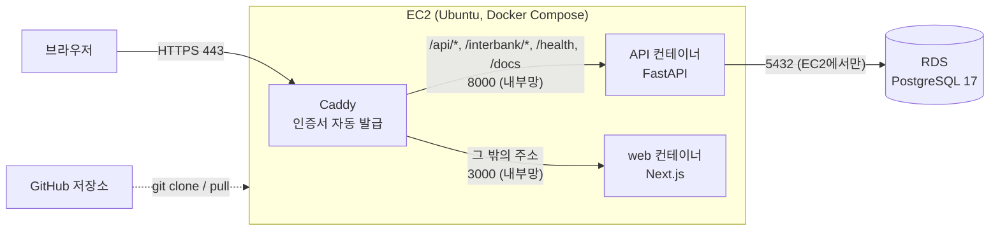

# 배포 정리 (AWS)

처음 배포한 과정(2026-11-06)과, 다시 접속하거나 코드를 고쳐 다시 올릴 때 할 일을 정리했다.
왜 이렇게 골랐는지는 [RETROSPECTIVE.md](RETROSPECTIVE.md) 2번, 자세한 기록은 [DESIGN_CHANGES.md](DESIGN_CHANGES.md) C-052~C-054에 있다.

> IP, 비밀번호, 키 파일 경로는 저장소에 적지 않는다. 아래 `<...>`는 내 값으로 바꿔 읽는다.

## 한눈에 보기



- 주소는 `https://<IP의 점을 하이픈으로>.sslip.io`. 도메인 없이 sslip.io가 이름을 IP로 돌려준다.
- 리전은 ap-southeast-2(시드니). EC2와 RDS는 **같은 리전**이어야 서로 연결된다.

## 처음 배포한 흐름

| 순서 | 어디서 | 한 일 | 이유 |
|---|---|---|---|
| 1 | AWS 콘솔 | MFA, $1 예산 알림 | 요금 사고 방지 |
| 2 | EC2 | Ubuntu 24.04, t3.micro, 20GiB, **크레딧 사양 표준**, 보안 그룹(22=내 IP, 80·443=전체) | 무제한 크레딧은 추가 요금 가능 |
| 3 | EC2 | 탄력적 IP 연결 | 껐다 켜도 주소(=도메인)가 그대로 |
| 4 | RDS | **전체 구성으로 생성** → PostgreSQL 17, 프리 티어, db.t4g.micro, **EC2 컴퓨팅 리소스에 연결**, **초기 DB 이름 `avengers_bank`** | "빠른 구성"은 Aurora(유료)로 만들어진다 |
| 5 | 서버(SSH) | Docker 설치, 스왑 2GB | 메모리 1GB라 빌드 중 멈춤 방지 |
| 6 | 서버 | `git clone` → `.env.prod` 작성 | 비밀 값은 서버에만 둔다 |
| 7 | 서버 | 컨테이너 실행 → 마이그레이션 → 시드 | 아래 명령 |
| 8 | 브라우저 | `/health`, `/docs`에서 가입·로그인 확인 | |

5~7번 명령:

```bash
curl -fsSL https://get.docker.com | sudo sh && sudo usermod -aG docker ubuntu   # 그다음 exit 후 재접속
sudo fallocate -l 2G /swapfile && sudo chmod 600 /swapfile && sudo mkswap /swapfile && sudo swapon /swapfile && echo '/swapfile none swap sw 0 0' | sudo tee -a /etc/fstab

git clone https://github.com/s100422/avengers-bank.git && cd avengers-bank
cp .env.prod.example .env.prod && nano .env.prod

docker compose -f docker-compose.prod.yml --env-file .env.prod up -d --build
docker compose -f docker-compose.prod.yml --env-file .env.prod run --rm api alembic upgrade head
docker compose -f docker-compose.prod.yml --env-file .env.prod run --rm api python -m avengers_bank.seed
```

`.env.prod`에 넣은 것:

```
DOMAIN=<IP의 점을 하이픈으로>.sslip.io
DATABASE_URL=postgresql+psycopg://<마스터 사용자>:<비밀번호>@<RDS 엔드포인트>:5432/avengers_bank
JWT_SECRET_KEY=<python3 -c "import secrets; print(secrets.token_urlsafe(48))" 결과>
ENABLE_DEV_ENDPOINTS=false
# CORS_ORIGINS는 프론트 주소(https://<DOMAIN>)를 넣는다. 프론트를 배포한 뒤의 값은 아래 "프론트 배포" 절
```

## 다시 접속할 때

```powershell
ssh -i <키 파일 .pem 경로> ubuntu@<탄력적 IP>
```

```bash
cd ~/avengers-bank
docker compose -f docker-compose.prod.yml --env-file .env.prod ps   # api(healthy), caddy가 Up이면 정상
```

SSH가 끊겨도 컨테이너는 계속 돈다. 서버에서 `ln -s .env.prod .env`와 `export COMPOSE_FILE=docker-compose.prod.yml`(`~/.bashrc`)을 해 두면 `docker compose ps`처럼 짧게 쓸 수 있다.

## 코드를 고쳐 다시 올릴 때

```
내 PC: 커밋 → git push
서버:  git pull → up -d --build → (모델을 바꿨으면) alembic upgrade head
```

```bash
cd ~/avengers-bank && git pull
docker compose -f docker-compose.prod.yml --env-file .env.prod up -d --build
docker compose -f docker-compose.prod.yml --env-file .env.prod run --rm api alembic upgrade head
```

`.env.prod`만 바꿨으면 `--build` 없이 `up -d`만 하면 된다.

### 2026-11-10 미배포 변경을 올릴 때

현재 로컬 작업본에는 이체 요청 ID, 휴대폰 변경·탈퇴 보호, 입출금 알림, 마이그레이션 `d3e4f5a6b7c8`·`e4f5a6b7c8d9`가 들어 있다. 프론트와 API를 **같은 소스 버전**으로 빌드한다. 운영의 기존 10,000원 이체는 출금됐으나 DB에서 `PENDING`이고 허브의 서명 검증된 조회 결과가 `UNKNOWN`이다(환불 내역 없음). 이 거래는 완료·실패가 확정되지 않았으므로 재송금하지 않는다. 이전 API의 요청 ID가 새 API의 거래 ID와 같다고 가정하지 않는다.

1. 운영 서버의 현재 Git 상태와 `alembic current`를 읽기 전용으로 확인하고 RDS 스냅샷을 만든다.
2. 검증한 변경만 커밋·푸시한다. 작업 시작 전부터 있던 `SPEC.md`, `frontend/app/design/`, `frontend/app/layout.tsx`의 포함 여부는 별도로 확인한다.
3. 서버에서 같은 커밋으로 `api`와 `web` 이미지를 빌드한다. 운영 DB에 마이그레이션을 적용한 뒤 **API를 먼저**, 웹을 그다음 올린다.
4. `/health`, 새 `request_id`·알림 API 경로, 로그인 화면 CSS를 확인한다. 로그인·이체·환불과 허브 서명 경로는 별도 기능 검증으로 확인한다.

두 마이그레이션은 기존 행을 삭제하지 않고 컬럼·인덱스·알림 테이블을 추가하며 허용 목적·폐기 사유 제약을 확장한다. 배포에 실패하면 이전 API·웹 이미지를 다시 올릴 수 있지만, 운영 DB를 즉시 downgrade하지 말고 데이터와 마이그레이션 상태를 먼저 확인한다. Windows `next build`의 Turbopack 프로세스 오류는 Linux Docker 이미지 빌드에서는 재현되지 않았다.

실행 결과(2026-11-10): 사용자가 수동 스냅샷 `before-transfer-notifications-20261110` 생성 완료를 확인했다. `main`의 코드 커밋 `86d85bf`로 API·웹 이미지를 빌드하고 운영 DB를 `e4f5a6b7c8d9`까지 올렸다. API를 먼저, 웹을 다음에 교체했고 둘 다 healthy다. 공개 HTTPS `/health` 200, `/login` 및 CSS 200, 인증 없는 새 알림·이체 상태 API 401을 확인했다. 기존 10,000원 타행 이체는 배포 뒤에도 1건 `PENDING`, 출금 내역 1건, 환불 내역 0건, 마지막 발송 시각 변경 없음이다. 이 거래의 완료·실패는 아직 확정되지 않았다.

## 2026-11-09~10 배포 (타행 이체·AI 비서·이체 화면)

두 번째 배포다. 서버는 `main` 브랜치를 받는다(`git pull origin main`). 서버가 오래된 커밋(`49dfefa`)에 머물러 있어서 마이그레이션 10개가 한꺼번에 적용됐고, 모두 표·컬럼을 추가하는 변경이었다. **배포 전에 RDS 스냅샷**을 찍었다(스냅샷 이름은 영문자로 시작하고 영문·숫자·하이픈만 가능: 예 `before-interbank-20261109`).

접속과 배포 명령은 위 "코드를 고쳐 다시 올릴 때"와 같다. 빌드는 메모리 1GB 서버에서 몇 분 걸리므로 백그라운드로 돌리는 편이 안전하다.

```bash
cd ~/avengers-bank && git pull origin main
docker compose -f docker-compose.prod.yml --env-file .env.prod build
docker compose -f docker-compose.prod.yml --env-file .env.prod run --rm api alembic upgrade head
docker compose -f docker-compose.prod.yml --env-file .env.prod up -d api
```

마지막 배포(2026-11-10)는 `main` `fa7b4bd`이고 `alembic current`가 `c2d3e4f5a6b7`(head)였다. 배포 뒤 `/health` 200, 새 API(`/transfers/recent` 등)와 `/interbank/inquiry`가 로그인·서명 없이 401을 주는 것으로 라우터가 올라온 것을 확인했다.

### `.env.prod`에 추가한 값

| 변수 | 용도 | 비고 |
|---|---|---|
| `HUB_PUBLIC_KEY`, `BANK_PRIVATE_KEY` | 타행 이체 받는 쪽(허브 서명 검증·응답 서명) | 개인키는 채팅·저장소에 올리지 않고 서버 파일에 직접 넣는다 |
| `BANK_CODE`, `BANK_API_KEY` | 타행 이체 보내는 쪽 | 허브 등록 응답에서 받는다 ([INTERBANK.md](INTERBANK.md)) |
| `GEMINI_API_KEY` | AI 금융 비서·약관 검색 | 없으면 AI 비서가 "아직 설정되지 않았습니다" |

값 수정은 `.env.prod`만 바꿨으면 `--build` 없이 `up -d api`로 충분하다. 파일 권한은 600으로 둔다.

### 새 기능을 올릴 때 같이 할 일 (운영 DB 데이터)

코드를 올려도 **운영 DB 데이터**는 따로 맞춰야 하는 것들이다. 도커 이미지에는 `docs/`가 없어서 약관 원문 폴더를 볼륨으로 붙여 실행한다.

```bash
D="docker compose -f docker-compose.prod.yml --env-file .env.prod run --rm"
$D api python -m avengers_bank.seed                      # 없는 상품만 추가한다 (이미 있으면 건너뜀)
$D -v $PWD/docs:/app/docs:ro api python -m avengers_bank.domains.terms.publish --effective-from 2026-11-09
$D -v $PWD/docs:/app/docs:ro api python -m avengers_bank.domains.terms.indexing   # GEMINI_API_KEY 필요
```

- 순서가 중요하다: 시드 → 약관 발행 → 색인. 약관 발행은 상품 이름으로 연결해서, 시드가 옛 상품만 있으면 실패한다.
- 마이그레이션 `a7c4e6f8b0d2`가 `CREATE EXTENSION vector`를 실행한다(RDS 마스터 사용자로 통과했다).
- 운영은 `ENABLE_DEV_ENDPOINTS=false`라 개발용 충전 API가 닫혀 있다. 시험용 잔액은 DB에서 직접 넣어야 한다(거래내역에 `DEV_CHARGE` 한 줄을 남긴다). 시험이 끝나면 지운다.

### 현재 주소와 등록 정보

- 화면과 API 모두 `https://<탄력적 IP의 점을 하이픈으로>.sslip.io` 한 주소다(화면은 서버에 배포했다, 아래 "프론트 배포"). 로컬 프론트로 서버 API를 쓰려면 `API_ORIGIN=<위 주소>/api npm run dev -- -p 5173`(끝에 `/api`)로 붙이고 포트를 5173에 맞춘다.
- 허브에는 은행 코드 `903`(SpiderBank)으로 등록돼 있고 `base_url`은 위 주소 뒤에 `/interbank`다.
- `.env.prod`의 `CORS_ORIGIN`은 코드가 읽는 이름(`CORS_ORIGINS`)과 달라 무시되고 있었다. 프론트 배포 때 지우고 `CORS_ORIGINS=https://<DOMAIN>,http://localhost:5173`으로 바로잡았다.

## 프론트 배포 (2026-11-10, C-110)

화면(Next.js)도 같은 서버에 올렸다. 컨테이너가 하나 늘어(`web`) Caddy 뒤에 `api`, `web` 둘이 있다.

- **이미지**: `frontend/Dockerfile`(실행에 필요한 파일만 담는 `output: "standalone"`). 이미지 313MB, 실행 메모리 약 50MB. 메모리 1GB 서버에서도 빌드가 됐다(스왑 사용).
- **주소 나누기**(`deploy/Caddyfile`): `/interbank/*`(허브가 부르는 타행 이체), `/health`, `/docs`, `/openapi.json`, `/redoc`은 API로 바로 간다. `/api/*`는 앞의 `/api`를 떼고 API로 간다(화면과 같은 출처라 갱신 토큰 쿠키가 자사 쿠키가 된다). 나머지는 모두 화면.
- **옛 직접 API 주소는 닫혔다**: 예전에는 `https://<DOMAIN>/transfers/recent`처럼 API를 바로 불렀지만 이제 `https://<DOMAIN>/api/transfers/recent`다(앞 경로는 화면이 받아 404). 로컬 개발용 `API_ORIGIN`도 끝에 `/api`를 붙인다.
- **로그인 쿠키**: 브라우저 경로가 `/api/users`로 같고 HTTPS라 `Secure` 쿠키가 동작한다. 갱신·로그아웃의 출처 검사가 `CORS_ORIGINS`에 서버 주소가 있어야 통과하므로 `.env.prod`에 `https://<DOMAIN>`을 넣었다.
- **운영 빌드 조건**: `next build`는 개발 서버보다 엄격해서(캐시 컴포넌트의 프리렌더 검사) 렌더링 중 `Date.now()`·`useParams`를 쓰는 화면이 있으면 실패한다. 그래서 `app/layout.tsx`에서 화면 전체를 `Suspense`로 감쌌다. 새 화면을 만들 때 로컬에서 `npm run build`로 먼저 확인한다.

올리는 명령(전체 배포와 같고 `web`이 추가됐다):

```bash
cd ~/avengers-bank && git pull origin main
C="docker compose -f docker-compose.prod.yml --env-file .env.prod"
$C build            # api와 web. 서버 메모리가 모자라면 web만 따로: $C build web
$C run --rm api alembic upgrade head
$C up -d
$C restart caddy    # Caddyfile을 바꿨을 때(파일을 붙여 쓰는 방식이라 자동 반영되지 않는다)
```

바꾼 뒤에는 **허브 경로가 API에 닿는지** 먼저 본다: `curl -i -X POST https://<DOMAIN>/interbank/inquiry -d '{}'`가 `401 SIGNATURE_INVALID`와 `X-Response-Signature` 헤더를 주면 정상(이 경로가 화면으로 새면 타행 이체 받기가 멈춘다).

## 겪은 문제

| 증상 | 원인 | 해결 |
|---|---|---|
| RDS가 Aurora로 만들어짐 | "빠른 구성으로 생성"을 누름 | 지우고 "전체 구성 → PostgreSQL"로 다시 |
| `required variable DOMAIN is missing` | `--env-file .env.prod`를 빼먹음 | 모든 compose 명령에 붙이기 |
| SSH `Connection timed out` | 내 IP가 바뀜(장소 이동, 와이파이 변경 등). 이 문서를 쓰는 동안에도 두 번 겪었다 | 보안 그룹 22번 규칙을 "내 IP"로 다시 저장 |
| 계좌 개설이 `TERMS_NOT_CONFIGURED` | 운영 DB에 약관이 발행되지 않음(상품 시드가 옛 이름이라 약관 발행도 실패) | 아래 "새 기능을 올릴 때 같이 할 일"의 시드 → 약관 발행 |
| 마이그레이션 시간 초과 | RDS 생성 때 "EC2에 연결"을 안 함, 또는 리전이 다름 | RDS 보안 그룹 확인 |
| `database "avengers_bank" does not exist` | RDS 초기 DB 이름을 비워 둠 | RDS에서 DB 생성 또는 다시 만들기 |

## 비용 메모

EC2, RDS, 퍼블릭 IPv4, EBS가 크레딧에서 빠진다. 안 쓸 때는 EC2와 RDS를 **중지**할 수 있다(RDS는 7일 뒤 자동으로 다시 켜짐). 다 쓰면 RDS 삭제 → EC2 종료 → **탄력적 IP 릴리스** 순서로 정리한다.
