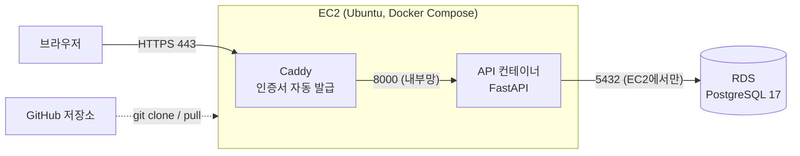

# 배포 정리 (AWS)

처음 배포한 과정(2026-11-06)과, 다시 접속하거나 코드를 고쳐 다시 올릴 때 할 일을 정리했다.
왜 이렇게 골랐는지는 [RETROSPECTIVE.md](RETROSPECTIVE.md) 2번, 자세한 기록은 [DESIGN_CHANGES.md](DESIGN_CHANGES.md) C-052~C-054에 있다.

> IP, 비밀번호, 키 파일 경로는 저장소에 적지 않는다. 아래 `<...>`는 내 값으로 바꿔 읽는다.

## 한눈에 보기



- 주소는 `https://<IP의 점을 하이픈으로>.sslip.io`. 도메인 없이 sslip.io가 이름을 IP로 돌려준다.
- 리전은 ap-southeast-2(시드니). EC2와 RDS는 **같은 리전**이어야 서로 연결된다.

## 처음 배포한 흐름

| 순서 | 어디서 | 한 일 | 이유 |
|---|---|---|---|
| 1 | AWS 콘솔 | MFA, $1 예산 알림 | 요금 사고 방지 |
| 2 | EC2 | Ubuntu 24.04, t3.micro, 20GiB, **크레딧 사양 표준**, 보안 그룹(22=내 IP, 80·443=전체) | 무제한 크레딧은 추가 요금 가능 |
| 3 | EC2 | 탄력적 IP 연결 | 껐다 켜도 주소(=도메인)가 그대로 |
| 4 | RDS | **전체 구성으로 생성** → PostgreSQL 17, 프리 티어, db.t4g.micro, **EC2 컴퓨팅 리소스에 연결**, **초기 DB 이름 `avengers_bank`** | "빠른 구성"은 Aurora(유료)로 만들어진다 |
| 5 | 서버(SSH) | Docker 설치, 스왑 2GB | 메모리 1GB라 빌드 중 멈춤 방지 |
| 6 | 서버 | `git clone` → `.env.prod` 작성 | 비밀 값은 서버에만 둔다 |
| 7 | 서버 | 컨테이너 실행 → 마이그레이션 → 시드 | 아래 명령 |
| 8 | 브라우저 | `/health`, `/docs`에서 가입·로그인 확인 | |

5~7번 명령:

```bash
curl -fsSL https://get.docker.com | sudo sh && sudo usermod -aG docker ubuntu   # 그다음 exit 후 재접속
sudo fallocate -l 2G /swapfile && sudo chmod 600 /swapfile && sudo mkswap /swapfile && sudo swapon /swapfile && echo '/swapfile none swap sw 0 0' | sudo tee -a /etc/fstab

git clone https://github.com/s100422/avengers-bank.git && cd avengers-bank
cp .env.prod.example .env.prod && nano .env.prod

docker compose -f docker-compose.prod.yml --env-file .env.prod up -d --build
docker compose -f docker-compose.prod.yml --env-file .env.prod run --rm api alembic upgrade head
docker compose -f docker-compose.prod.yml --env-file .env.prod run --rm api python -m avengers_bank.seed
```

`.env.prod`에 넣은 것:

```
DOMAIN=<IP의 점을 하이픈으로>.sslip.io
DATABASE_URL=postgresql+psycopg://<마스터 사용자>:<비밀번호>@<RDS 엔드포인트>:5432/avengers_bank
JWT_SECRET_KEY=<python3 -c "import secrets; print(secrets.token_urlsafe(48))" 결과>
ENABLE_DEV_ENDPOINTS=false
# CORS_ORIGINS는 프론트를 배포하면 그 주소를 넣는다
```

## 다시 접속할 때

```powershell
ssh -i <키 파일 .pem 경로> ubuntu@<탄력적 IP>
```

```bash
cd ~/avengers-bank
docker compose -f docker-compose.prod.yml --env-file .env.prod ps   # api(healthy), caddy가 Up이면 정상
```

SSH가 끊겨도 컨테이너는 계속 돈다. 서버에서 `ln -s .env.prod .env`와 `export COMPOSE_FILE=docker-compose.prod.yml`(`~/.bashrc`)을 해 두면 `docker compose ps`처럼 짧게 쓸 수 있다.

## 코드를 고쳐 다시 올릴 때

```
내 PC: 커밋 → git push
서버:  git pull → up -d --build → (모델을 바꿨으면) alembic upgrade head
```

```bash
cd ~/avengers-bank && git pull
docker compose -f docker-compose.prod.yml --env-file .env.prod up -d --build
docker compose -f docker-compose.prod.yml --env-file .env.prod run --rm api alembic upgrade head
```

`.env.prod`만 바꿨으면 `--build` 없이 `up -d`만 하면 된다.

## 겪은 문제

| 증상 | 원인 | 해결 |
|---|---|---|
| RDS가 Aurora로 만들어짐 | "빠른 구성으로 생성"을 누름 | 지우고 "전체 구성 → PostgreSQL"로 다시 |
| `required variable DOMAIN is missing` | `--env-file .env.prod`를 빼먹음 | 모든 compose 명령에 붙이기 |
| SSH `Connection timed out` | 내 IP가 바뀜(장소 이동) | 보안 그룹 22번 규칙을 "내 IP"로 다시 저장 |
| 마이그레이션 시간 초과 | RDS 생성 때 "EC2에 연결"을 안 함, 또는 리전이 다름 | RDS 보안 그룹 확인 |
| `database "avengers_bank" does not exist` | RDS 초기 DB 이름을 비워 둠 | RDS에서 DB 생성 또는 다시 만들기 |

## 비용 메모

EC2, RDS, 퍼블릭 IPv4, EBS가 크레딧에서 빠진다. 안 쓸 때는 EC2와 RDS를 **중지**할 수 있다(RDS는 7일 뒤 자동으로 다시 켜짐). 다 쓰면 RDS 삭제 → EC2 종료 → **탄력적 IP 릴리스** 순서로 정리한다.
