# ER 다이어그램

- 원본 파일: [`AvengersBankDiagram.drawio`](AvengersBankDiagram.drawio). [draw.io](https://app.diagrams.net)에서 열어서 수정합니다.
- **현재 코드에 맞춘 최신 다이어그램:** [`AvengersBankDiagram_v2.drawio`](AvengersBankDiagram_v2.drawio). 코드의 모델에서 자동으로 만듭니다(`uv run python scripts/generate_erd_drawio.py`). 위 원본은 최초 설계 그대로 두었고 지금 코드와 다릅니다. 노란 칸이 팀 초기 설계에서 바뀐 곳입니다.
- 아래 다이어그램은 같은 내용을 GitHub에서 바로 볼 수 있도록 Mermaid로 옮긴 것입니다. drawio를 수정하면 이 문서도 함께 고쳐 주세요.
- 코드의 모델은 `src/avengers_bank/domains/*/models.py`에 있습니다.

```mermaid
erDiagram
    users {
        int user_id PK
        string login_id UK
        string hashed_password
        string name
        string nick_name "NULL"
        string phone
        datetime created_at
        datetime phone_verified_at "NULL, 휴대폰 인증 시각(가입·번호 변경)"
        smallint failed_login_count "연속 로그인 실패 횟수, 기본 0"
        datetime login_locked_at "NULL, 5회 연속 실패로 잠긴 시각"
        datetime deleted_at "NULL, 회원 탈퇴 시각(소프트 삭제, C-095)"
        smallint device_failed_login_count "등록 기기 채널 연속 실패 횟수, 기본 0(C-096)"
        datetime device_login_locked_at "NULL, 등록 기기 채널 잠금 시각(C-096)"
    }

    refresh_tokens {
        int refresh_token_id PK
        int user_id FK "index"
        string family_id "index, 로그인 1번 = family 1개(36자)"
        string token_hash UK "SHA-256, 원문 저장 안 함"
        datetime expires_at
        datetime created_at
        datetime revoked_at "NULL, 폐기 시각"
        int replaced_by_id FK "NULL, 자기참조: 교체된 다음 토큰"
        string revoked_reason "NULL, ROTATED/LOGOUT/LOGOUT_ALL/PASSWORD_CHANGED/REUSE_DETECTED/LOGIN_ELSEWHERE/WITHDRAWN"
    }

    user_devices {
        int device_id PK
        int user_id FK "index"
        string token_hash UK "SHA-256, 기기 쿠키 원문 저장 안 함"
        string label "예: Chrome · Windows"
        datetime created_at
        datetime last_used_at
        datetime revoked_at "NULL, 해제 시각"
    }

    verification_codes {
        int verification_id PK
        string purpose "SIGNUP_PHONE/CHANGE_PHONE/PASSWORD_RESET/FIND_LOGIN_ID/ACCOUNT_PASSWORD_RESET/WITHDRAWAL/NEW_DEVICE"
        string phone
        int user_id FK "NULL, 가입 전에는 없음"
        string code_hash "HMAC-SHA256, 원문 저장 안 함"
        smallint attempts "확인 시도 횟수, 최대 5"
        datetime expires_at "발송 후 10분"
        datetime verified_at "NULL, 확인 성공"
        datetime consumed_at "NULL, 증표 1회 사용"
        datetime created_at
    }

    account_products {
        int product_id PK
        string type "CHECKING/DEPOSIT/SAVINGS"
        string name
        string product_code UK "NULL, 약관 manifest와 연결하는 안정적인 코드"
        text description
        decimal interest_rate "연 금리(%)"
        bigint min_amount "NULL, 최소 가입 금액(원), 예금 상품만"
    }

    card_products {
        int product_id PK
        string type "CREDIT/DEBIT"
        string name
        string product_code UK "NULL, 약관 manifest와 연결하는 안정적인 코드"
        text description
        bigint credit_limit "NULL, 신용카드 상품만"
    }

    checking_accounts {
        int checking_account_id PK
        int user_id FK
        int product_id FK
        string account_num UK
        bigint balance
        bigint per_transfer_limit "1회 이체 한도"
        bigint daily_transfer_limit "1일 이체 한도"
        string nickname "NULL"
        datetime created_at
        string password_hash "NULL, 계좌 비밀번호(숫자 4자리) argon2 해시"
        smallint password_failed_count "연속 실패, 기본 0"
        datetime password_locked_at "NULL, 5회 실패로 잠긴 시각"
        datetime closed_at "NULL, 회원 탈퇴로 닫힌 시각(닫힌 계좌로는 입금 불가, C-095)"
    }

    deposit_accounts {
        int deposit_account_id PK
        int user_id FK
        int product_id FK
        string account_num UK
        bigint balance
        date maturity_date
        string nickname "NULL"
        datetime created_at
        string status "ACTIVE / CLOSED"
        datetime closed_at "NULL, 해지 시각"
        string password_hash "NULL, 계좌 비밀번호(숫자 4자리) argon2 해시"
        smallint password_failed_count "연속 실패, 기본 0"
        datetime password_locked_at "NULL, 5회 실패로 잠긴 시각"
    }

    savings_accounts {
        int savings_account_id PK
        int user_id FK
        int product_id FK
        string account_num UK
        bigint balance
        bigint monthly_payment
        smallint monthly_deposit_date "매월 납입일 1~31"
        date maturity_date
        string nickname "NULL"
        datetime created_at
        string status "ACTIVE / CLOSED"
        datetime closed_at "NULL, 해지 시각"
        string password_hash "NULL, 계좌 비밀번호(숫자 4자리) argon2 해시"
        smallint password_failed_count "연속 실패, 기본 0"
        datetime password_locked_at "NULL, 5회 실패로 잠긴 시각"
    }

    checking_account_histories {
        int checking_account_history_id PK
        int checking_account_id FK
        datetime date
        bigint amount "항상 양수"
        bigint balance_after "거래 후 잔액"
        string type "TRANSFER_OUT/…/CLOSE_IN, INTERBANK_OUT/INTERBANK_IN/INTERBANK_REFUND(C-105)"
        string counterpart_account "NULL, 상대 계좌번호(50자, 타행 계좌번호까지 담음)"
        string counterpart_name "NULL, 상대 이름(실명)·가맹점명(체크카드 결제). 타행은 사람 이름만(C-108)"
    }

    deposit_account_histories {
        int deposit_account_history_id PK
        int deposit_account_id FK
        datetime date
        bigint amount "항상 양수"
        bigint balance_after "거래 후 잔액"
        string type
        string counterpart_account "NULL, 상대 계좌번호"
    }

    savings_account_histories {
        int savings_account_history_id PK
        int savings_account_id FK
        datetime date
        bigint amount "항상 양수"
        bigint balance_after "거래 후 잔액"
        string type
        string counterpart_account "NULL, 상대 계좌번호"
    }

    credit_cards {
        int credit_card_id PK
        int user_id FK
        int product_id FK
        int checking_account_id FK "결제 계좌"
        string card_num UK
        bigint credit_limit "신용 한도"
        bigint outstanding_amount "미결제액, 0~credit_limit"
        smallint payment_date "매월 결제일 1~31"
        string status "ACTIVE / SUSPENDED / CLOSED"
    }

    debit_cards {
        int debit_card_id PK
        int user_id FK
        int product_id FK
        int checking_account_id FK "출금 계좌"
        string card_num UK
        bigint accumulated_amount
        string status "ACTIVE / SUSPENDED / CLOSED"
    }

    credit_card_histories {
        int credit_card_history_id PK
        int credit_card_id FK
        string place_of_use
        bigint used_amount
        datetime time
        int bill_id FK "NULL = 청구 전"
    }

    credit_card_bills {
        int bill_id PK
        int credit_card_id FK
        date period_start "UK(credit_card_id, period_start)"
        date period_end
        bigint total_amount
        date due_date
        string status "UNPAID/PAID"
        datetime paid_at "NULL"
        datetime created_at
    }

    debit_card_histories {
        int debit_card_history_id PK
        int debit_card_id FK
        string place_of_use
        bigint used_amount
        datetime time
    }

    interbank_transfers {
        string transfer_id PK "소문자 UUID v4(36자), 같은 ID는 한 번만 들어감(멱등성)"
        string direction "OUT(보냄)/IN(받음)"
        int checking_account_id FK "index, 우리 쪽 입출금 계좌"
        string peer_bank "상대 은행 코드(3자리)"
        string peer_bank_name "NULL"
        string peer_account "상대 계좌번호(50자)"
        string peer_name "NULL, OUT: 받는 분, IN: 보낸 분"
        bigint amount "양수"
        string memo "기본 빈 문자열, 100자"
        string status "index, PENDING/COMPLETED/FAILED"
        string fail_code "NULL, 40자"
        string fail_message "NULL, 200자"
        datetime created_at
        datetime finished_at "NULL"
        datetime last_sent_at "NULL, 허브로 마지막 POST한 시각"
    }

    favorite_accounts {
        int favorite_id PK
        int user_id FK "index"
        string bank_code "3자리, 우리 은행은 빈 문자열(NULL 아님), UK(user_id, bank_code, account)"
        string bank_name
        string account "50자"
        string name "NULL, 즐겨찾기 때의 이름"
        datetime created_at
    }

    agent_conversations {
        int conversation_id PK
        int user_id FK "index"
        datetime created_at
    }

    agent_messages {
        int agent_message_id PK
        int conversation_id FK
        string role "user/assistant"
        text content
        json tool_calls "NULL, Tool 이름·성공 여부만"
        json action "NULL, 이체 확인 action(마스킹)"
        json citations "NULL, 서버가 검증한 약관 출처"
        datetime created_at
    }

    agent_transfer_drafts {
        string draft_id PK "추측 불가 임의 문자열(43자)"
        int user_id FK "index"
        int from_checking_account_id FK
        string to_account_num
        string recipient_name
        bigint amount "양수"
        string status "PENDING/EXECUTED/EXPIRED/CANCELLED"
        datetime expires_at
        datetime executed_at "NULL"
        datetime created_at
    }

    terms_versions {
        int terms_version_id PK
        string document_key "UK(document_key, version)"
        string version
        string title
        string document_type
        date effective_from
        string status "published/retired"
        text body "front matter 뺀 정규화 Markdown"
        string body_sha256
        json meta "원본 front matter"
        datetime published_at
    }

    product_terms_revisions {
        int revision_id PK
        string product_kind "checking/deposit/savings/credit/debit, UK(product_kind, product_id, revision)"
        int product_id "FK 없음(종류별 테이블이 다름)"
        int revision
        string set_hash
        datetime created_at
    }

    product_terms_items {
        int revision_id PK, FK
        int terms_version_id PK, FK
        boolean required
        int display_order
    }

    terms_consents {
        int consent_id PK
        int user_id FK "index"
        string subject_kind "checking/deposit/savings/credit/debit"
        int subject_id "가입한 계좌·카드 ID, FK 없음"
        int revision_id FK
        int terms_version_id FK
        boolean required
        boolean agreed
        string body_sha256 "동의 당시 본문 해시"
        datetime recorded_at
    }

    terms_index_generations {
        int generation_id PK
        string embedding_model
        int dimensions "0보다 큼"
        string chunker_version
        string status "building/active/retired, active는 1개만"
        datetime created_at
        datetime activated_at "NULL"
    }

    terms_index_entries {
        int generation_id PK, FK
        int terms_version_id PK, FK
        string status "ready/failed"
        int chunk_count
        text error "NULL"
        datetime updated_at
    }

    terms_chunks {
        int chunk_id PK
        int generation_id FK
        int terms_version_id FK
        int ordinal "UK(generation_id, terms_version_id, ordinal)"
        string section_id
        string section_title
        string heading_path
        int char_start
        int char_end
        text text
        string text_sha256
        vector embedding "PostgreSQL pgvector, SQLite는 JSON"
    }

    users ||--o{ refresh_tokens : "로그인 세션"
    refresh_tokens |o--o| refresh_tokens : "교체(replaced_by_id)"
    users ||--o{ user_devices : "등록 기기"
    users ||--o{ agent_conversations : "AI 비서 대화"
    users ||--o{ agent_transfer_drafts : "이체 초안"
    users ||--o{ terms_consents : "약관 동의"
    users ||--o{ checking_accounts : "보유"
    users ||--o{ deposit_accounts : "보유"
    users ||--o{ savings_accounts : "보유"
    users ||--o{ credit_cards : "보유"
    users ||--o{ debit_cards : "보유"
    users |o--o{ verification_codes : "인증번호"

    account_products ||--o{ checking_accounts : "상품"
    account_products ||--o{ deposit_accounts : "상품"
    account_products ||--o{ savings_accounts : "상품"
    card_products ||--o{ credit_cards : "상품"
    card_products ||--o{ debit_cards : "상품"

    checking_accounts ||--o{ checking_account_histories : "거래"
    deposit_accounts ||--o{ deposit_account_histories : "거래"
    savings_accounts ||--o{ savings_account_histories : "거래"

    checking_accounts ||--o{ credit_cards : "결제 계좌"
    checking_accounts ||--o{ debit_cards : "출금 계좌"

    credit_cards ||--o{ credit_card_histories : "사용"
    credit_cards ||--o{ credit_card_bills : "청구"
    credit_card_bills |o--o{ credit_card_histories : "포함"

    agent_conversations ||--o{ agent_messages : "메시지"
    checking_accounts ||--o{ agent_transfer_drafts : "출금 계좌"
    checking_accounts ||--o{ interbank_transfers : "타행 이체(보냄·받음)"
    users ||--o{ favorite_accounts : "자주 쓰는 계좌"

    terms_versions ||--o{ product_terms_items : "구성"
    product_terms_revisions ||--o{ product_terms_items : "약관 집합"
    product_terms_revisions ||--o{ terms_consents : "동의 당시 집합"
    terms_versions ||--o{ terms_consents : "동의한 버전"
    terms_index_generations ||--o{ terms_index_entries : "색인 상태"
    terms_versions ||--o{ terms_index_entries : "색인 상태"
    terms_index_generations ||--o{ terms_chunks : "조각"
    terms_versions ||--o{ terms_chunks : "조각"
    debit_cards ||--o{ debit_card_histories : "사용"
```

## 테이블 요약

| 테이블 | 설명 | 도메인 |
|---|---|---|
| `users` | 회원. `phone_verified_at`(휴대폰 인증 시각), `failed_login_count`·`login_locked_at`('새 기기' 채널: 5회 연속 실패면 잠금, 비밀번호 찾기·관리자 명령으로 해제), `device_failed_login_count`·`device_login_locked_at`('등록 기기' 채널, 따로 센다, C-096), `deleted_at`(탈퇴 시각, 행은 지우지 않는 소프트 삭제, C-095) | users |
| `refresh_tokens` | 갱신 토큰 1개 = 1행(SHA-256 해시만 저장). `family_id`가 세션 1개, `replaced_by_id` 자기참조로 회전·재사용 감지. CHECK: 교체됨 → 폐기 상태, `revoked_reason`은 목록 안의 값이고 폐기된 행에만 있음. 만료·폐기 행은 쌓이기만 함(정리 작업 없음) | users |
| `user_devices` | 등록 기기(새 기기 휴대폰 인증 통과 시 생성, 쿠키 해시만 저장). `revoked_at`이 있으면 해제된 기기 | users |
| `verification_codes` | 휴대폰 인증번호 1번 발송 = 1행. 코드는 HMAC만 저장, `purpose` CHECK 제약(`SIGNUP_PHONE`·`CHANGE_PHONE`·`PASSWORD_RESET`·`FIND_LOGIN_ID`·`ACCOUNT_PASSWORD_RESET`·`WITHDRAWAL`·`NEW_DEVICE`), 인덱스 `(phone, purpose, created_at)`. 번호당 발송 제한(15분 3번)도 이 행을 센다 | verification |
| `account_products` / `card_products` | 계좌 상품 / 카드 상품. `type` CHECK, `product_code` UNIQUE(NULL 가능, 약관 연결용), `account_products.min_amount`: NULL이면 제한 없음·값이 있으면 `> 0` CHECK, `card_products.credit_limit`: 신용은 필수 `> 0`·체크는 NULL(CHECK) | products |
| `checking_accounts` / `deposit_accounts` / `savings_accounts` | 입출금 / 예금 / 적금 계좌. `balance >= 0` CHECK, 입출금은 `per_transfer_limit <= daily_transfer_limit` CHECK, 예금·적금은 `status`와 `closed_at`이 맞아야 함(CHECK), 적금 `monthly_deposit_date` 1~31 CHECK. 입출금의 `closed_at`은 회원 탈퇴로 닫힌 시각(예금·적금의 해지와 다름). 3종 모두 `password_hash`(NULL = 미설정, 돈이 나가지 않음)·`password_failed_count`·`password_locked_at`(5회 실패 잠금) | accounts |
| `*_account_histories` | 계좌별 거래내역. `amount > 0`·`balance_after >= 0`·`type` 목록 CHECK(입출금: `TRANSFER_OUT`/`TRANSFER_IN`/`TO_SAVINGS`/`TO_DEPOSIT`/`CARD_PAYMENT`/`CARD_BILL_PAYMENT`/`DEV_CHARGE`/`CLOSE_IN`/`INTERBANK_OUT`/`INTERBANK_IN`/`INTERBANK_REFUND`, 예금·적금: `TRANSFER_IN`/`INTEREST`/`CLOSE_OUT`), 인덱스 `(계좌 ID, date)` | accounts |
| `interbank_transfers` | 타행 이체 기록(C-105). 보낸 것(`OUT`)과 받은 것(`IN`)을 한 표에 둠. `transfer_id`(UUID)가 PK라 같은 ID는 한 번만 들어가고, 이것이 받는 쪽 멱등성(중복 입금 방지)의 근거. `OUT`의 `PENDING` 행은 돈이 이미 나갔고 허브 결과를 기다리는 상태. CHECK: `amount > 0`, `direction`(`OUT`/`IN`), `status`(`PENDING`/`COMPLETED`/`FAILED`), 인덱스 `status`·`checking_account_id`. `checking_account_id`는 FK, 상대 은행·계좌·이름은 FK 없는 문자열 | interbank |
| `favorite_accounts` | 이체 화면의 자주 쓰는 계좌(C-107). UNIQUE `(user_id, bank_code, account)`. 우리 은행은 `bank_code = ''`(PostgreSQL 유니크가 NULL끼리 다르게 봐서 NULL 대신 빈 문자열). 이름·은행 이름은 추가할 때 값을 그대로 저장(표시용). 인덱스 `user_id` | transfers |
| `credit_cards` / `debit_cards` | 신용카드 / 체크카드 | cards |
| `*_card_histories` | 카드별 사용내역 | cards |
| `credit_card_bills` | 신용카드 청구서. UNIQUE `(credit_card_id, period_start)`, `total_amount > 0`, `period_end >= period_start`, `status`와 `paid_at`이 맞아야 함(CHECK) | cards |
| `agent_conversations` / `agent_messages` | AI 비서 대화 / 메시지(`role` CHECK, 인덱스 `(conversation_id, agent_message_id)`). Tool 원본 결과는 저장하지 않고 이름·성공 여부(`tool_calls`), 마스킹된 이체 확인 `action`, 약관 출처 `citations`만 남김 | agent |
| `agent_transfer_drafts` | AI가 만든 이체 초안. 사용자가 화면에서 확인해야 실행됨. `status` CHECK, `amount > 0` CHECK | agent |
| `terms_versions` | 발행한 약관의 불변 스냅샷. UNIQUE `(document_key, version)`, `status` CHECK(`published`/`retired`) | terms |
| `product_terms_revisions` / `product_terms_items` | 상품별 "가입 때 동의할 약관 집합"(바뀌면 revision을 하나 더 쌓음) / 그 구성(복합 PK). UNIQUE `(product_kind, product_id, revision)`, `product_kind` CHECK. 계좌·카드 상품 ID가 겹칠 수 있어 종류와 함께 쓰고 FK는 두지 않음 | terms |
| `terms_consents` | 가입 때 서버가 기록한 동의. UNIQUE `(subject_kind, subject_id, terms_version_id)`, 인덱스 `(subject_kind, subject_id)`, `subject_id`는 FK 없음(종류별 테이블이 다름) | terms |
| `terms_index_generations` / `terms_index_entries` / `terms_chunks` | 약관 검색 색인(언제든 다시 만들 수 있는 데이터). 세대(`status` CHECK, `active`는 부분 UNIQUE 인덱스로 1개만, `dimensions > 0`) / 세대 안 버전별 상태(복합 PK, `ready`/`failed`) / 조각(UNIQUE `(generation_id, terms_version_id, ordinal)`, `embedding`은 PostgreSQL에서 pgvector, SQLite에서 JSON) | terms |

## 코드에서 지켜야 할 규칙

DB 구조만으로는 막을 수 없는 부분이라 애플리케이션 코드에서 보장해야 합니다.

1. **계좌번호는 종류별 앞자리로 발급:** 입출금 `110-`, 예금 `120-`, 적금 `220-`로 시작합니다(`110-XXX-XXXXXX`). 앞자리가 달라서 테이블 사이에서 겹치지 않습니다. 계좌번호는 `accounts.service`에서만 발급하고, 같은 테이블 안에서 겹치면(unique 제약 `IntegrityError`) 새 번호로 재시도합니다.
2. **돈 이동은 한 트랜잭션으로:** 이체, 적금 납입, 체크카드 결제, 신용카드 청구서 납부는 잔액 변경과 History 저장(양쪽 모두)을 `async with db.begin():` 블록 하나 안에서 처리합니다.
3. **상품 종류 검증:** 계좌를 개설하거나 카드를 발급할 때 상품의 `type`이 계좌·카드 종류와 맞는지 확인합니다. 신용카드를 발급할 때는 상품의 `credit_limit`을 카드의 `credit_limit`으로 복사합니다.
4. **`outstanding_amount`(신용)·`accumulated_amount`(체크) 동기화:** 카드 History를 저장할 때 이 값도 같이 증가시킵니다. 신용카드의 `outstanding_amount`는 **미결제액**이라서 청구서를 납부하면 청구 금액만큼 줄이고, 결제 때 `미결제액 + 결제 금액 <= credit_limit`을 검사합니다. (체크카드는 누적 사용액 그대로)
5. **금액은 정수(원):** 금액 컬럼은 모두 `BIGINT`입니다. 실수형(`float`)은 쓰지 않습니다.
6. **거래내역 금액은 양수, 방향은 `type`:** 계좌 거래내역의 `amount`는 항상 양수(CHECK 제약)이고 입금·출금은 `type`으로 구분합니다. `balance_after`에는 그 거래를 반영한 뒤의 계좌 잔액을 같은 트랜잭션에서 기록합니다. `counterpart_account`는 입금이면 보낸 계좌, 출금이면 받는 계좌의 번호입니다(타행 계좌번호까지 담으려고 50자). `counterpart_name`은 사람 이름(실명)이나 가맹점 이름만 쓰고, 타행 이체(`INTERBANK_*`)도 은행 이름을 붙이지 않은 사람 이름만 저장합니다(C-108).
7. **하루 기준은 KST:** 1일 이체 한도의 "오늘"은 한국 시간(Asia/Seoul) 00:00부터입니다. 코드에서 오늘 00:00 KST를 UTC 시각으로 바꿔 `date >= 그 시각`으로 조회합니다.
8. **신용카드 청구는 API 호출로:** 스케줄러가 없으므로 본인이 청구서 생성·납부 API를 호출합니다. 이용 기간은 전월 1일~말일(KST), 납부 예정일은 다음 달 결제일(그 달에 없는 날이면 말일)입니다. 부분 납부·연체 이자·리볼빙은 범위 밖입니다.
9. **돈이 움직이기 전에 행 잠금:** 잔액·한도·청구서 상태를 바꾸는 처리는 해당 행을 `SELECT ... FOR UPDATE`(`with_for_update()`)로 **먼저 잠그고, 잠근 뒤에** 검사합니다. 잠그기 전에 읽은 값으로 검사하면 동시 요청이 둘 다 통과합니다.
   - 잠금 순서는 항상 같게: 입출금 계좌(ID 오름차순) → 예금·적금 계좌 → 카드 → 청구서. 순서가 다르면 두 요청이 서로를 기다리는 데드락이 생깁니다.
   - 로그인 세션(`refresh_tokens`)·등록 기기(`user_devices`)를 바꾸는 작업은 **사용자 행(`users`) → 갱신 토큰·기기** 순서로 잠급니다(C-088, C-096). 아직 생기지 않은 새 토큰·기기 행은 잠글 수 없어서, 사용자 행으로 같은 사용자의 로그인·갱신·로그아웃·비밀번호 변경·기기 등록을 한 줄로 세웁니다. 회원 탈퇴(`users/withdrawal.py`)도 사용자 행을 먼저 잠근 뒤 계좌 등으로 내려갑니다(`users` → … → 계좌).
   - 계좌 비밀번호 검증(`accounts/password.py` `check_account_password`)은 본 작업 전에 **그 계좌 행 하나만 잠그는 짧은 트랜잭션을 먼저 커밋**합니다(실패 횟수 증가가 롤백되지 않게). 행 하나만 잠그고 끝나므로 위 잠금 순서와 엮여 데드락이 생기지 않습니다.
   - 잠금 쿼리에는 `.execution_options(populate_existing=True)`를 붙여 세션에 남아 있는 예전 값을 최신 값으로 덮어씁니다.
   - 테스트 DB(SQLite)는 `FOR UPDATE`를 무시하므로 동시성 테스트는 PostgreSQL에서 해야 합니다.
10. **타행 이체는 `transfer_id`로 한 번만, 환불은 확정 실패일 때만(C-105):** 받는 쪽은 입금과 `interbank_transfers` 저장을 한 트랜잭션에서 하고, 같은 `transfer_id`가 다시 오면(동시에 온 경우의 PK 충돌 포함) 입금하지 않고 저장된 결과를 돌려줍니다(4xx로 답하지 않음). 보내는 쪽은 출금과 `PENDING` 행 저장을 한 트랜잭션으로 하고, 허브 응답이 `FAILED`로 확정됐을 때만 환불(`INTERBANK_REFUND`)합니다. 타임아웃·5xx·서명이 틀린 응답은 `PENDING`으로 두고 확인 작업이 허브에 다시 물어봅니다(이중 지급 방지).

## 팀에서 정해야 할 것

- 각 `type` 컬럼에 들어갈 값 목록. 계좌 거래내역은 현재 코드가 `TRANSFER_OUT`, `TRANSFER_IN`, `TO_SAVINGS`, `TO_DEPOSIT`, `DEV_CHARGE`, `CLOSE_IN`, 타행 이체 `INTERBANK_OUT`·`INTERBANK_IN`·`INTERBANK_REFUND`를 쓴다(`accounts/kinds.py`). `TO_DEPOSIT`은 예금 가입 금액을 낼 때만 생긴다(가입 후 추가 입금은 없음). 카드 관련은 `CARD_PAYMENT`(체크카드 결제), `CARD_BILL_PAYMENT`(청구서 납부)를 쓴다(`cards/kinds.py`)
- 카드번호 형식: 지금은 신용 `4000-`, 체크 `5000-` + 무작위 12자리(`cards/kinds.py`), 실제 카드번호 체계(Luhn 검사 등)는 아님
- 이체 한도 기본값
