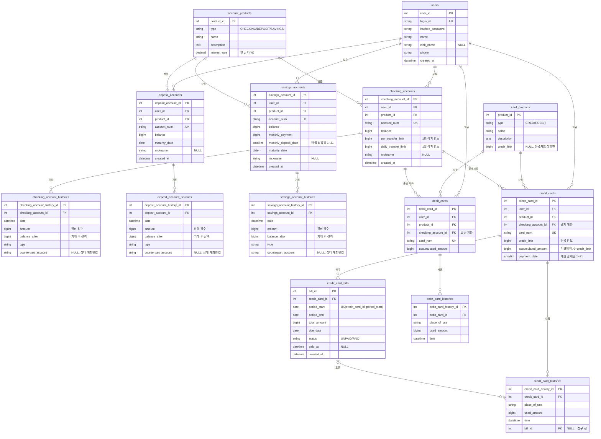

# ER 다이어그램

- 원본 파일: [`AvengersBankDiagram.drawio`](AvengersBankDiagram.drawio). [draw.io](https://app.diagrams.net)에서 열어서 수정합니다.
- **현재 코드에 맞춘 최신 다이어그램:** [`AvengersBankDiagram_v2.drawio`](AvengersBankDiagram_v2.drawio). 코드의 모델에서 자동으로 만듭니다(`uv run python scripts/generate_erd_drawio.py`). 위 원본은 최초 설계 그대로 두었고 지금 코드와 다릅니다. 노란 칸이 팀 초기 설계에서 바뀐 곳입니다.
- 아래 다이어그램은 같은 내용을 GitHub에서 바로 볼 수 있도록 Mermaid로 옮긴 것입니다. drawio를 수정하면 이 문서도 함께 고쳐 주세요.
- 코드의 모델은 `src/avengers_bank/domains/*/models.py`에 있습니다.

## 테이블 요약

| 테이블 | 설명 | 도메인 |
|---|---|---|
| `users` | 회원 | users |
| `account_products` / `card_products` | 계좌 상품 / 카드 상품 | products |
| `checking_accounts` / `deposit_accounts` / `savings_accounts` | 입출금 / 예금 / 적금 계좌 | accounts |
| `*_account_histories` | 계좌별 거래내역 | accounts |
| `credit_cards` / `debit_cards` | 신용카드 / 체크카드 | cards |
| `*_card_histories` | 카드별 사용내역 | cards |
| `credit_card_bills` | 신용카드 청구서 | cards |

## 코드에서 지켜야 할 규칙

DB 구조만으로는 막을 수 없는 부분이라 애플리케이션 코드에서 보장해야 합니다.

1. **계좌번호는 종류별 앞자리로 발급:** 입출금 `110-`, 예금 `120-`, 적금 `220-`로 시작합니다(`110-XXX-XXXXXX`). 앞자리가 달라서 테이블 사이에서 겹치지 않습니다. 계좌번호는 `accounts.service`에서만 발급하고, 같은 테이블 안에서 겹치면(unique 제약 `IntegrityError`) 새 번호로 재시도합니다.
2. **돈 이동은 한 트랜잭션으로:** 이체, 적금 납입, 체크카드 결제, 신용카드 청구서 납부는 잔액 변경과 History 저장(양쪽 모두)을 `async with db.begin():` 블록 하나 안에서 처리합니다.
3. **상품 종류 검증:** 계좌를 개설하거나 카드를 발급할 때 상품의 `type`이 계좌·카드 종류와 맞는지 확인합니다. 신용카드를 발급할 때는 상품의 `credit_limit`을 카드의 `credit_limit`으로 복사합니다.
4. **`accumulated_amount` 동기화:** 카드 History를 저장할 때 이 값도 같이 증가시킵니다. 신용카드에서는 **미결제액**이라서 청구서를 납부하면 청구 금액만큼 줄이고, 결제 때 `미결제액 + 결제 금액 <= credit_limit`을 검사합니다. (체크카드는 누적 사용액 그대로)
5. **금액은 정수(원):** 금액 컬럼은 모두 `BIGINT`입니다. 실수형(`float`)은 쓰지 않습니다.
6. **거래내역 금액은 양수, 방향은 `type`:** 계좌 거래내역의 `amount`는 항상 양수(CHECK 제약)이고 입금·출금은 `type`으로 구분합니다. `balance_after`에는 그 거래를 반영한 뒤의 계좌 잔액을 같은 트랜잭션에서 기록합니다. `counterpart_account`는 입금이면 보낸 계좌, 출금이면 받는 계좌의 번호입니다.
7. **하루 기준은 KST:** 1일 이체 한도의 "오늘"은 한국 시간(Asia/Seoul) 00:00부터입니다. 코드에서 오늘 00:00 KST를 UTC 시각으로 바꿔 `date >= 그 시각`으로 조회합니다.
8. **신용카드 청구는 API 호출로:** 스케줄러가 없으므로 본인이 청구서 생성·납부 API를 호출합니다. 이용 기간은 전월 1일~말일(KST), 납부 예정일은 다음 달 결제일(그 달에 없는 날이면 말일)입니다. 부분 납부·연체 이자·리볼빙은 범위 밖입니다.
9. **돈이 움직이기 전에 행 잠금:** 잔액·한도·청구서 상태를 바꾸는 처리는 해당 행을 `SELECT ... FOR UPDATE`(`with_for_update()`)로 **먼저 잠그고, 잠근 뒤에** 검사합니다. 잠그기 전에 읽은 값으로 검사하면 동시 요청이 둘 다 통과합니다.
   - 잠금 순서는 항상 같게: 입출금 계좌(ID 오름차순) → 예금·적금 계좌 → 카드 → 청구서. 순서가 다르면 두 요청이 서로를 기다리는 데드락이 생깁니다.
   - 잠금 쿼리에는 `.execution_options(populate_existing=True)`를 붙여 세션에 남아 있는 예전 값을 최신 값으로 덮어씁니다.
   - 테스트 DB(SQLite)는 `FOR UPDATE`를 무시하므로 동시성 테스트는 PostgreSQL에서 해야 합니다.

## 팀에서 정해야 할 것

- 각 `type` 컬럼에 들어갈 값 목록. 계좌 거래내역은 현재 코드가 `TRANSFER_OUT`, `TRANSFER_IN`, `TO_SAVINGS`, `TO_DEPOSIT`, `DEV_CHARGE`를 쓴다(`accounts/kinds.py`). 카드 관련은 `CARD_PAYMENT`(체크카드 결제), `CARD_BILL_PAYMENT`(청구서 납부)를 쓴다(`cards/kinds.py`)
- 카드번호 형식: 지금은 신용 `4000-`, 체크 `5000-` + 무작위 12자리(`cards/kinds.py`), 실제 카드번호 체계(Luhn 검사 등)는 아님
- 이체 한도 기본값
