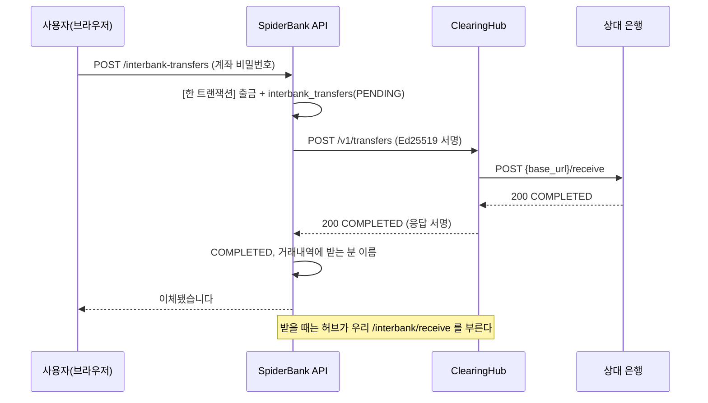

# 타행 이체 (ClearingHub 연동)

SpiderBank가 은행 간 이체 중계 서버(ClearingHub)를 통해 다른 은행으로 보내고 받는 방법을 정리했다. 규격 원문은 저장소 루트의 `SPEC.md`(허브 쪽 문서 `docs/SPEC.md` 사본, 아직 커밋하지 않음)이고, 이 문서는 **우리 구현이 규격의 어디를 어떻게 지키는지**와 운영 방법을 적는다. 설계 이유와 변경 전후는 [DESIGN_CHANGES.md](DESIGN_CHANGES.md) C-105, C-108, 선택의 배경은 [RETROSPECTIVE.md](RETROSPECTIVE.md) 7번.

> 키·초대 코드·API 키 같은 비밀 값은 이 문서와 저장소에 적지 않는다. 아래 `<...>`는 내 값으로 바꿔 읽는다.

## 한눈에 보기

- **보내는 쪽**: `domains/interbank/service.py`, 허브 호출 `hub_client.py`
- **받는 쪽**: `domains/interbank/receiver.py` (허브가 부르는 API 3개)
- **결과를 모르는 거래 확인**: `domains/interbank/worker.py`
- **서명**: `domains/interbank/signing.py` (규격 2.2·2.5 그대로)

## 등록 정보와 설정

| 항목 | 값 |
|---|---|
| 은행 이름 / 코드 | `SpiderBank` / `903` (허브가 배정) |
| 허브 주소 | `https://clearing-hub.ai-agent-develop.cloud` |
| 우리 `base_url` | `https://3-105-205-183.sslip.io/interbank` (EC2의 Caddy가 `/interbank`를 API로 넘긴다) |
| 순채무한도 | 10억 원(허브 기본값, 규격 10.2) |

환경 변수(`.env`, 운영은 서버의 `.env.prod`). 하나라도 비면 타행 이체가 꺼진다(`503 INTERBANK_DISABLED`).

| 변수 | 설명 | 비밀 |
|---|---|---|
| `HUB_URL` | 허브 주소 | 아니오 |
| `HUB_PUBLIC_KEY` | 허브 공개키(지문 `37021b33778cec72`로 확인) | 아니오 |
| `BANK_CODE` | 등록 때 받은 은행 코드 | 아니오 |
| `BANK_NAME` | 기본 `SpiderBank` | 아니오 |
| `BANK_API_KEY` | 등록 응답에 한 번만 나오는 식별용 키 | **예** |
| `BANK_PRIVATE_KEY` | 우리 Ed25519 개인키(base64 32바이트) | **예** |

받는 쪽 `/interbank`는 `HUB_PUBLIC_KEY`와 `BANK_PRIVATE_KEY` 두 값만 있으면 켜진다(등록 직후 허브의 `ping`이 통과하도록). 보내기에는 네 값이 모두 필요하다. `HUB_INVITE_CODE`는 등록 때만 쓰는 일회용 값이라 앱은 읽지 않는다.

## 등록 절차 (처음 한 번)

1. Ed25519 키 쌍을 만든다(규격 빠른 시작 1단계). 개인키는 서버 `.env.prod`의 `BANK_PRIVATE_KEY`에만 둔다.
2. 서버에 `/interbank`가 떠 있게 배포한다(받는 쪽 API가 허브의 `ping`에 답해야 한다).
3. `POST <허브>/v1/banks/register`에 `invite_code`, `name`, `base_url`, `public_key`를 보낸다.
4. 응답의 `ping.ok`가 `true`인지, 응답의 `hub_public_key`로 **직접 계산한** 지문이 따로 받은 지문과 같은지 확인한다(`hub_fingerprint` 필드는 믿지 않는다).
5. 응답의 `bank_code`·`api_key`를 `.env.prod`에 저장하고 API를 다시 시작한다. `api_key`는 이 응답에만 나온다.

초대 코드는 한 번만 쓸 수 있고 7일 뒤 만료된다. `ping.ok`가 `false`여도 등록은 된 것이니 등록을 다시 보내지 않는다.

## 보내기 (규격 3절, 6절)

순서(`InterbankService.send`):

1. 비밀번호·한도 확인: 계좌 비밀번호, 잔액, 1회·1일 한도(타행 이체도 1일 한도에 센다).
2. **한 트랜잭션**으로 출금하고 `interbank_transfers`에 `PENDING`으로 저장한다 (`transfer_id`는 UUID v4). 이 PENDING 행이 규격의 "중간 계정"이다.
3. 허브 `POST /v1/transfers` (서명). 응답의 서명을 허브 공개키로 검증한다.
4. 결과를 반영한다.

| 허브 응답 | 우리 처리 |
|---|---|
| 200 + 본문 `status: COMPLETED` | 완료. 거래내역의 받는 분 이름을 허브가 알려 준 예금주 실명으로 채운다 |
| 4xx + 본문 `status: FAILED` | **이때만** 출금을 되돌린다(`INTERBANK_REFUND`). 사용자에게 오류(`ACCOUNT_NOT_FOUND` 등)를 보여 준다 |
| 202, `status` 없는 4xx, 5xx, 타임아웃, **서명이 틀린 응답** | 결과를 모르는 상태: 되돌리지 않고 `PENDING`으로 둔다 → 확인 작업이 처리 |

되돌릴지는 HTTP 상태나 오류 코드가 아니라 **본문의 `status`**로만 정한다. 허브 응답을 모르는 채 되돌리면 받는 쪽에도 돈이 있고 보낸 사람 계좌에도 돈이 있는 이중 지급이 된다.

허브 호출은 이체 서비스 안에서만 한다. AI 비서(LLM)의 도구로는 주지 않았다(규격 6절). AI 비서의 타행 이체(C-125)도 도구는 초안만 만들고(은행 목록·수취 조회만), 송금은 사용자가 확인 카드를 눌렀을 때 이 서비스가 한다.

### 확인 작업 (`worker.py`)

서버가 시작될 때 바로 한 번, 그 뒤 30초마다 `PENDING`인 타행 보냄을 `GET /v1/transfers/{id}`로 확인한다. 서버 재시작 복구(규격 6절 5)도 이것이 겸한다.

- `COMPLETED` / `FAILED` → 위 표대로 마무리(환불은 행을 잠그고 한 번만).
- 조회가 `404 TRANSFER_NOT_FOUND` → 되돌리지 않고, 마지막 POST 뒤 1분이 지났으면 같은 `transfer_id`로 다시 POST(멱등).
- 그 밖/연결 실패 → 다음 주기에 다시.

알려진 한계(코드의 `shortcut:` 주석): 30분 뒤에도 30초 간격(규격은 10분으로 늦추라 함), 서버 프로세스 1개 전제(Dockerfile의 uvicorn 워커 1개).

## 받기 (규격 4절)

허브가 부르는 API 3개. 로그인 쿠키가 아니라 **허브의 Ed25519 서명**으로 인증하고, 오류 형식이 우리 다른 API와 다르다(`{"error": CODE, "message": ...}`).

| 경로 | 용도 |
|---|---|
| `POST /interbank/inquiry` | 받는 계좌의 예금주 이름 (없으면 404 `ACCOUNT_NOT_FOUND`) |
| `POST /interbank/receive` | 입금 |
| `GET /interbank/receive/{transfer_id}` | 입금 여부 확인 (없으면 404 `TRANSFER_NOT_FOUND`) |

지키는 것:

- 서명은 JSON으로 풀기 **전의 원본 바이트**로 허브 공개키로 검증하고, `X-Bank-Code`가 `"000"`인지 본다. 서명 경로는 `/interbank` 뒤의 부분(`/receive`)이다. 검증은 입금 처리보다 먼저 한다.
- 2xx·4xx 응답(서명 실패 401 포함)에 응답 서명을 붙인다(`SignResponses` 미들웨어). 5xx에는 붙이지 않는다.
- **멱등성**: `transfer_id`가 `interbank_transfers`의 기본키다. 같은 ID가 다시 오면 입금하지 않고 `200 COMPLETED`를 준다.
- **동시 중복**: 입금 기록과 입금은 한 트랜잭션이고, 동시에 같은 ID가 오면 기본키 충돌이 난다. 이때 **4xx로 답하지 않는다**(허브가 4xx를 입금 안 됨으로 보고 보내는 은행이 환불해 이중 지급이 된다). 저장된 결과를 읽어 200, 못 읽으면 503.
- 입금하지 않은 거래(거절한 것 포함)는 저장하지 않는다. 그래야 확인 API가 404를 준다.
- 거래내역에는 보낸 분 **이름만** 남긴다(은행 이름 없음, C-108).

## 화면과 사용자 API

| 경로 | 용도 |
|---|---|
| `GET /interbank-transfers/banks` | 참가 은행 목록(우리 은행 제외) |
| `POST /interbank-transfers/inquiry` | 받는 분 이름 조회(화면이 가려서 보여 줌) |
| `POST /interbank-transfers` | 타행 이체(계좌 비밀번호 필요). `COMPLETED` 또는 `PENDING`(201), 확정 실패는 환불 후 오류 |
| `GET /interbank-transfers/{transfer_id}` | 결과 조회(화면이 처리 중이면 5초마다 최대 1분) |

우리 은행 안 이체용 `POST /transfers/inquiry`, `GET /transfers/recent`, `GET·POST·DELETE /transfers/favorites`도 이체 화면이 쓴다. 자세한 요청·응답은 [API_ENDPOINTS.md](API_ENDPOINTS.md), 표 구조는 [ERD.md](ERD.md).

## 시험

- 자동 테스트: `tests/test_interbank.py` — 규격 2.3·2.5의 예시 서명 값 일치, 허브는 `httpx.MockTransport`. 보내기(완료/확정 실패 환불/타임아웃·5xx·서명 틀림은 PENDING 유지), 확인 작업, 받기(1회 입금, 응답 서명, 동시 같은 ID에서 4xx 없음) 등.
- 실제 허브 시험(규격 7절): 가짜 은행 `902`의 계좌 `110-123-0001`은 항상 정상 입금, 끝자리 `0002` 계좌 없음, `0003` 지연, `0004` 5xx 두 번 뒤 성공, `0005` 입금은 됐는데 응답 없음. 받는 쪽은 `POST /v1/test-receive`(셀프 시험)로 허브가 우리 계좌에 입금해 본다.
- 401이 나면 응답의 `hint`, 그다음 `GET /v1/diagnose/failures`(서명 없이 `X-Bank-Code`·`X-Api-Key`).

## 운영 메모

- 허브가 우리 서버를 직접 부르므로 `base_url`은 공개 HTTPS(공인 인증서)여야 한다. 지금은 `sslip.io` 주소 + Caddy 자동 인증서. IP가 바뀌면 `PATCH /v1/me`로 `base_url`을 바꾼다(새 주소로 먼저 ping해 통과해야 반영됨).
- 서버 시계는 NTP로 맞춘다(서명 시각 허용 오차 5분).
- 개인키·API 키는 서버 `.env.prod`에만 둔다. 유출되면 허브 관리자에게 재발급·키 교체를 요청한다(규격 2.6).

## 하지 않은 것 / 남은 것

- 정산·대사(규격 10절), 본인 명의 계좌 조회(규격 9절)
- 탈퇴 시 `PENDING` 타행 이체가 있으면 막기(환불 대상 계좌가 닫힌 경우)
- 확인 작업의 간격 늦춤·다중 프로세스 대비
